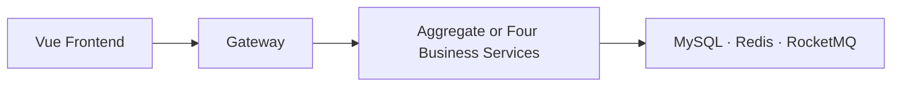

# 12306 Repository Study

[All studies](../../README.md) · [Backend Engineering](../README.md)

> **Table of Contents**
>
> - [0. Overview](#0-overview)
> - [1. Backend](#1-backend)
> - [2. Engineering Coverage](#2-engineering-coverage)

## 0. Overview

> A railway ticketing system with aggregate and microservice deployment modes.

> - Source: [nageoffer/12306](https://github.com/nageoffer/12306).
> - Revision: `main` at [`daf3a27`](https://github.com/nageoffer/12306/commit/daf3a2714c00ff263764d23ab10c2eaed2ae842d).
> - Depth: High.
> - Status: Incomplete.

1. Frontend
   - `console-vue`: Vue 3 and Ant Design Vue 3.
2. [Backend](#1-backend)
   - Deployment modes (run one at a time)

     | Mode | Gateway | Business applications |
     | --- | --- | --- |
     | Aggregate | `gateway-service` | `aggregation-service` |
     | Microservice | `gateway-service` | `user-service` `ticket-service` `order-service` `pay-service` |

   - Shared frameworks: reusable libraries loaded by the applications.
3. Technology stack
   - Application foundation

     <table>
       <tbody>
         <tr><td>Java 17 · Spring Boot 3.0.7</td><td></td></tr>
         <tr><td>Spring Cloud 2022.0.3 · Alibaba 2022.0.0.0-RC2</td><td>Gateway, Feign, and Nacos discovery.</td></tr>
         <tr><td>MyBatis-Plus 3.5.3.1 · ShardingSphere 5.3.2</td><td>Aggregate: 16 table shards. Split services: database and table sharding.</td></tr>
         <tr><td>Hippo4j 1.5.0 · XXL-JOB 2.3.1</td><td>Seat-selection pool and cache-preheating jobs.</td></tr>
       </tbody>
     </table>

   - Data and integrations

     <table>
       <tbody>
         <tr><td>MySQL</td><td>Local development schemas; no replica configuration.</td></tr>
         <tr><td>Redis · Redisson 3.21.3</td><td>One configured server; inventory tokens and fair purchase locks.</td></tr>
         <tr><td>RocketMQ Starter 2.2.3</td><td>Payment events and delayed order closure; optional Canal cache updates.</td></tr>
         <tr><td>Sentinel · Alipay SDK 4.38.10.ALL</td><td>Sentinel dashboard configured; no checked-in flow rules.</td></tr>
       </tbody>
     </table>

4. Setup
   - Runtime: Java 17; Maven 3.9.2 wrapper.
   - Database: `resources/db` and `resources/data`; choose the matching deployment layout.
   - Configure service YAML files and provision Redis, Nacos, and RocketMQ.
5. [Engineering Coverage](#2-engineering-coverage).
6. [Redis Integration](01-redis-integration.md): Redis configuration and usage in 12306.
7. [Database](database/README.md): The MySQL database structure used by 12306.
8. [Concurrency and Locking](concurrency-and-locking/README.md): Thread execution, thread state, and shared-operation coordination.

## 1. Backend

- Counts: mapped controller methods; shared handlers count once; Feign clients excluded.

| Component | API endpoints | Purpose |
| --- | ---: | --- |
| `gateway-service` | 0 | Routing and authentication. |
| `aggregation-service` | 0 | Alternative host for the four business services. |
| `user-service` | 14 | Accounts and passengers. |
| `ticket-service` | 14 | Ticket queries, purchases, and cache jobs. |
| `order-service` | 7 | Order lifecycle. |
| `pay-service` | 6 | Payments, refunds, and callbacks. |
| `frameworks` | 2 | Shared infrastructure and utility endpoints. |
| Total | 43 | Six application modules; shared frameworks. |

## 2. Engineering Coverage

> ✅ Covered · 🟡 Limited · ❌ Not covered · ❓ Unknown.

<table>
  <thead>
    <tr><th>L1 area</th><th>L2 area</th><th>Status</th></tr>
  </thead>
  <tbody>
    <tr><td rowspan="9"><a href="01-redis-integration.md">Caching</a></td><td>Basic cache usage</td><td>✅</td></tr>
    <tr><td>Redis cluster</td><td>❌</td></tr>
    <tr><td>Redis Sentinel</td><td>❌</td></tr>
    <tr><td>Redis server tuning</td><td>❌</td></tr>
    <tr><td>Cache penetration protection</td><td>✅</td></tr>
    <tr><td>Cache breakdown protection</td><td>✅</td></tr>
    <tr><td>Cache avalanche protection</td><td>🟡</td></tr>
    <tr><td>Cache pollution control</td><td>❌</td></tr>
    <tr><td>Database-cache consistency</td><td>🟡</td></tr>
    <tr><td rowspan="4"><a href="database/README.md">Database scaling</a></td><td>Database cluster</td><td>❌</td></tr>
    <tr><td>Replicas</td><td>❌</td></tr>
    <tr><td>Sharding</td><td>✅</td></tr>
    <tr><td>Read/write splitting</td><td>❌</td></tr>
    <tr><td rowspan="4"><a href="concurrency-and-locking/README.md#22-distributed-locking">Distributed locking</a></td><td>Distributed lock</td><td>✅</td></tr>
    <tr><td>Ownership-safe release</td><td>✅</td></tr>
    <tr><td>Lease renewal</td><td>🟡</td></tr>
    <tr><td>Redlock quorum</td><td>❌</td></tr>
    <tr><td rowspan="6"><a href="concurrency-and-locking/README.md#1-concurrency">Concurrency</a></td><td>Application-managed threads</td><td>✅</td></tr>
    <tr><td>Custom thread pool</td><td>✅</td></tr>
    <tr><td><code>CompletableFuture</code></td><td>❌</td></tr>
    <tr><td>JVM synchronization and locks</td><td>✅</td></tr>
    <tr><td>Atomic classes or CAS</td><td>✅</td></tr>
    <tr><td>Thread-local state</td><td>✅</td></tr>
    <tr><td rowspan="3"><a href="concurrency-and-locking/README.md#11-task-execution">Asynchronous processing</a></td><td>Application async executor</td><td>✅</td></tr>
    <tr><td>Scheduled background jobs</td><td>✅</td></tr>
    <tr><td>External asynchronous callbacks</td><td>✅</td></tr>
    <tr><td rowspan="5">Traffic handling</td><td>Spike-traffic strategy</td><td>✅</td></tr>
    <tr><td>Rate limiting</td><td>🟡</td></tr>
    <tr><td>Circuit breaker</td><td>❌</td></tr>
    <tr><td>Load testing</td><td>❌</td></tr>
    <tr><td>Stated capacity</td><td>❌</td></tr>
  </tbody>
</table>
