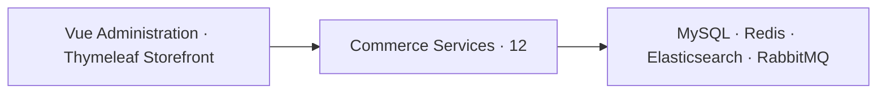

# GuliMall Repository Study

[All studies](../../README.md) · [Backend Engineering](../README.md)

> **Table of Contents**
>
> - [0. Overview](#0-overview)
> - [1. Backend](#1-backend)
> - [2. Engineering Coverage](#2-engineering-coverage)

## 0. Overview

> A Spring Boot e-commerce system with 12 main services.

> - Source: [shuhongfan/GuliMall](https://github.com/shuhongfan/GuliMall).
> - Revision: `main` at [`21bd319`](https://github.com/shuhongfan/GuliMall/commit/21bd319341feb8459e159a72eff050567bf29ccf).
> - Depth: High.
> - Status: Incomplete.

1. Frontend
   - Administration: `gulimall-vue`, using Vue 2.5.16 and Element UI 2.8.2.
   - Storefront: service-rendered Thymeleaf pages; static assets in `resource/static`.
2. [Backend](#1-backend): 12 commerce services and one shared library.
   - Business: 8 services covering the shopping lifecycle.
   - Platform: gateway, authentication, integrations, and administration.
   - Auxiliary: a generator and three SSO demos; bundled course copies are outside the study scope.
3. Technology stack
   - Application foundation

     <table>
       <tbody>
         <tr><td>Java 8</td><td></td></tr>
         <tr><td>Spring Boot 2.1.8.RELEASE</td><td>Administration uses 2.6.6.</td></tr>
         <tr><td>Spring Cloud Greenwich.SR3 · Alibaba 2.1.0.RELEASE</td><td></td></tr>
         <tr><td>MyBatis-Plus 3.2.0</td><td>Administration uses 3.3.1.</td></tr>
         <tr><td>Seata 0.9.0</td><td>Global transactions on product publication.</td></tr>
       </tbody>
     </table>

   - Data and messaging

     <table>
       <tbody>
         <tr><td>MySQL 8.0.27</td><td>SQL dump version; six schemas on one configured server.</td></tr>
         <tr><td>Redis · Redisson 3.12.0</td><td>One configured server.</td></tr>
         <tr><td>Elasticsearch client 7.6.2</td><td>One configured endpoint.</td></tr>
         <tr><td>RabbitMQ</td><td>One broker; TTL and dead-letter order closure.</td></tr>
       </tbody>
     </table>

   - Integrations

     <table>
       <tbody>
         <tr><td>Nacos · Sentinel</td><td>External configuration and traffic rules.</td></tr>
         <tr><td>Shiro 1.9.0 · Quartz 2.3.0</td><td>Administration.</td></tr>
         <tr><td>Alibaba OSS · SMS</td><td>OSS configuration comes from Nacos.</td></tr>
         <tr><td>Alipay · WeChat Pay</td><td></td></tr>
       </tbody>
     </table>

4. Setup
   - Build: Java 8 and Maven; frontend requires Node ≥ 8.11.1 and npm ≥ 5.6.0.
   - Database scripts: six schemas in `resource/db`.
   - Configuration: update service addresses and Nacos namespaces; supply OSS and payment settings.
5. [Engineering Coverage](#2-engineering-coverage).

## 1. Backend

> 12 commerce services and one shared library.

- Counts: mapped controller methods, including pages and demos; excludes Feign interfaces and auxiliary applications.

| Component | API endpoints | Purpose |
| --- | ---: | --- |
| `gulimall-product` | 103 | Catalog and product publication. |
| `gulimall-order` | 53 | Checkout, orders, and payments. |
| `gulimall-cart` | 7 | Shopping carts. |
| `gulimall-member` | 52 | Members and customer accounts. |
| `gulimall-coupon` | 77 | Promotions and sale sessions. |
| `gulimall-ware` | 37 | Inventory and purchasing. |
| `gulimall-search` | 2 | Product indexing and search. |
| `gulimall-seckill` | 3 | Flash-sale stock claims. |
| `gulimall-gateway` | 0 | Request routing. |
| `gulimall-auth-server` | 8 | Login, registration, and OAuth. |
| `gulimall-third-party` | 2 | Storage and messaging integrations. |
| `gulimall-admin` | 49 | Administration and scheduled jobs. |
| `gulimall-common` | 0 | Shared contracts and utilities. |
| Total | 393 | 12 services; one library. |

## 2. Engineering Coverage

> ✅ Covered · 🟡 Limited · ❌ Not covered · ❓ Unknown.

<table>
  <thead>
    <tr><th>L1 area</th><th>L2 area</th><th>Status</th></tr>
  </thead>
  <tbody>
    <tr><td rowspan="9">Caching</td><td>Basic cache usage</td><td>✅</td></tr>
    <tr><td>Redis cluster</td><td>❌</td></tr>
    <tr><td>Redis Sentinel</td><td>❌</td></tr>
    <tr><td>Redis server tuning</td><td>❌</td></tr>
    <tr><td>Cache penetration protection</td><td>✅</td></tr>
    <tr><td>Cache breakdown protection</td><td>🟡</td></tr>
    <tr><td>Cache avalanche protection</td><td>❌</td></tr>
    <tr><td>Cache pollution control</td><td>❌</td></tr>
    <tr><td>Database-cache consistency</td><td>🟡</td></tr>
    <tr><td rowspan="4">Database scaling</td><td>Database cluster</td><td>❌</td></tr>
    <tr><td>Replicas</td><td>❌</td></tr>
    <tr><td>Sharding</td><td>❌</td></tr>
    <tr><td>Read/write splitting</td><td>❌</td></tr>
    <tr><td rowspan="4">Distributed locking</td><td>Distributed lock</td><td>✅</td></tr>
    <tr><td>Ownership-safe release</td><td>✅</td></tr>
    <tr><td>Lease renewal</td><td>🟡</td></tr>
    <tr><td>Redlock quorum</td><td>❌</td></tr>
    <tr><td rowspan="6">Concurrency</td><td>Application-managed threads</td><td>🟡</td></tr>
    <tr><td>Custom thread pool</td><td>✅</td></tr>
    <tr><td><code>CompletableFuture</code></td><td>✅</td></tr>
    <tr><td>JVM synchronization and locks</td><td>🟡</td></tr>
    <tr><td>Atomic classes or CAS</td><td>❌</td></tr>
    <tr><td>Thread-local state</td><td>✅</td></tr>
    <tr><td rowspan="3">Asynchronous processing</td><td>Application async executor</td><td>✅</td></tr>
    <tr><td>Scheduled background jobs</td><td>✅</td></tr>
    <tr><td>External asynchronous callbacks</td><td>✅</td></tr>
    <tr><td rowspan="5">Traffic handling</td><td>Spike-traffic strategy</td><td>✅</td></tr>
    <tr><td>Rate limiting</td><td>🟡</td></tr>
    <tr><td>Circuit breaker</td><td>🟡</td></tr>
    <tr><td>Load testing</td><td>❌</td></tr>
    <tr><td>Stated capacity</td><td>❓</td></tr>
  </tbody>
</table>
