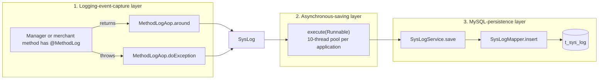

# Operation Audit Logging

[All studies](../../README.md) · [Backend Engineering](../README.md) · [Jeepay overview](README.md)

> **Table of Contents**
>
> - [0. Overview](#0-overview)
> - [1. How It Is Built](#1-how-it-is-built)
> - [2. How It Runs](#2-how-it-runs)

## 0. Overview

> Operation audit logging has four layers: logging data, logging-event capture, asynchronous saving, and MySQL persistence.

## 1. How It Is Built

1. Build the logging-data layer
   1. Create the logging marker: `MethodLog.java`
   2. Create the log-record model: `SysLog.java`
2. Build the logging-event-capture layer
   1. Capture annotated operations: `MethodLogAop.java` in `jeepay-manager` and `jeepay-merchant`
      - `@Component` registers an aspect bean in each application context; `@Aspect` marks its AOP role.
      - `around` records returned results; `doException` records thrown errors.
   2. Apply the logging marker by adding `@MethodLog` to the method.
3. Build the asynchronous-saving layer
   1. Create each application's executor: `Executors.newScheduledThreadPool(10)` in `MethodLogAop.java`
      - Declared type: `ScheduledExecutorService`.
      - Actual class: `ScheduledThreadPoolExecutor`, which extends `ThreadPoolExecutor`.
      - Each manager and merchant application has its own pool with core size 10.
   2. Submit saving tasks with `execute(Runnable)`.
      - The worker calls `SysLogService.save(sysLog)`.
4. Build the MySQL-persistence layer
   1. Create database access: `SysLogService.java`, `SysLogMapper.java`
   2. Use MyBatis-Plus's inherited `save` and `insert` methods.
   3. Create the log table: `t_sys_log`

## 2. How It Runs

