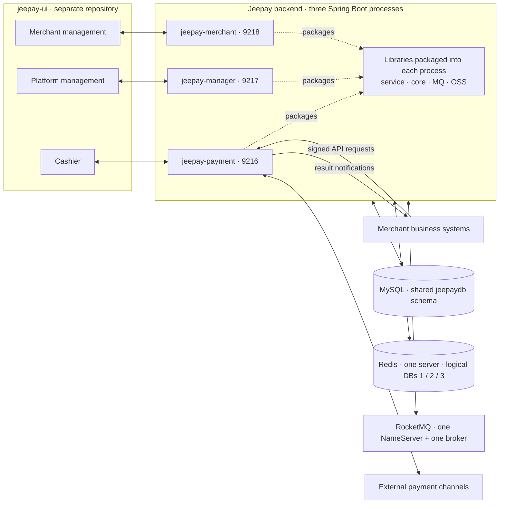

# Jeepay Repository Study

[All studies](../../README.md) · [Backend Engineering](../README.md)

> **Table of Contents**
>
> - [0. Overview](#0-overview)
> - [1. Backend](#1-backend)
> - [2. Engineering Coverage](#2-engineering-coverage)

## 0. Overview

> A Spring Boot payment platform with three applications, emphasizing order consistency and asynchronous notifications.

> - Source: [jeequan/jeepay](https://github.com/jeequan/jeepay).
> - Revision: `master` at [`e1ac908`](https://github.com/jeequan/jeepay/commit/e1ac9086d679826bab593f20431b7ecd292eb685).
> - Depth: High.
> - Status: Complete.
> - Inspected: `2026-10-01`.
> - Scope: Backend and embedded pages. [jeepay-ui](https://github.com/jeequan/jeepay-ui) remains uninspected.

1. Frontend
   - `jeepay-ui`: Cashier and management interfaces.
   - Embedded pages: Payment redirects and channel authorization.
2. [Backend](#1-backend)
   - Runtime applications
     - `jeepay-payment`: Payment gateway and channel integration.
     - `jeepay-manager`: Platform administration.
     - `jeepay-merchant`: Merchant administration.
   - Shared libraries and tooling
     - `jeepay-service`: Shared database services and mappers.
     - `jeepay-core`: Shared domain models and utilities.
     - `jeepay-components`: MQ adapters and file storage.
     - `jeepay-z-codegen`: MyBatis code generator.
3. Technology stack
   - Application foundation

     <table>
       <tbody>
         <tr><td>Java 17</td><td></td></tr>
         <tr><td>Spring Boot 3.3.7</td><td>Three processes sharing business libraries.</td></tr>
         <tr><td>Spring MVC</td><td>Backend APIs.</td></tr>
         <tr><td>FreeMarker</td><td>Embedded pages.</td></tr>
         <tr><td>Spring Security and JJWT 0.9.1</td><td>Management login state stored in Redis.</td></tr>
         <tr><td>Spring WebSocket</td><td>Three merchant notification endpoints.</td></tr>
         <tr><td>Fastjson compatibility API 2.0.57</td><td>Replaces Jackson in the applications.</td></tr>
         <tr><td>Knife4j 4.5.0</td><td></td></tr>
         <tr><td>Hutool 5.8.26</td><td></td></tr>
         <tr><td>Lombok</td><td></td></tr>
       </tbody>
     </table>

   - Persistence and caching

     <table>
       <tbody>
         <tr><td>MyBatis-Plus 3.5.7</td><td>Shared mappers across all three applications.</td></tr>
         <tr><td>Druid 1.2.28</td><td>Per-application pools: 5 initial, 5 minimum idle, 30 maximum.</td></tr>
         <tr><td>MySQL 8 · Compose image default</td><td>One server; shared <code>jeepaydb</code> schema.</td></tr>
         <tr><td>MySQL Connector/J 9.1.0</td><td></td></tr>
         <tr><td>Redis 6.2.14 · Compose image default</td><td>One server; logical DBs 1 / 2 / 3.</td></tr>
         <tr><td>In-process configuration maps</td><td>Development enabled; Compose disabled.</td></tr>
       </tbody>
     </table>

   - Messaging and external integrations

     <table>
       <tbody>
         <tr><td>RocketMQ 5.3.1</td><td>Default MQ; one NameServer and one broker.</td></tr>
         <tr><td>RocketMQ Spring starter 2.3.5</td><td>Shared MQ integration; delayed notifications.</td></tr>
         <tr><td>ActiveMQ adapter</td><td rowspan="3">Optional MQ adapter; currently inactive. Can be selected in place of RocketMQ.</td></tr>
         <tr><td>RabbitMQ adapter</td></tr>
         <tr><td>Aliyun RocketMQ adapter</td></tr>
         <tr><td>WxJava 4.7.2.B</td><td rowspan="3">Channel integrations inside the payment gateway.</td></tr>
         <tr><td>Alipay SDK 4.38.61.ALL</td></tr>
         <tr><td>PayPal Checkout SDK 1.0.5</td></tr>
         <tr><td>Jeepay Java SDK</td><td>Managed <code>1.6.1</code>; payment uses <code>pls-1.3.0</code>.</td></tr>
         <tr><td>Local file storage</td><td>Default storage.</td></tr>
         <tr><td>Aliyun OSS SDK 3.13.0</td><td>Optional cloud storage.</td></tr>
       </tbody>
     </table>

   - Build and deployment

     <table>
       <tbody>
         <tr><td>Maven</td><td>Application version <code>3.2.0</code>.</td></tr>
         <tr><td>Docker Compose</td><td>Three backend and three frontend containers.</td></tr>
       </tbody>
     </table>

4. Features
   - [Flows](flows/README.md): Traces complete user actions through the repository.
     - [Payment Order Creation](flows/01-payment-order-creation.md): Creates a payment order with a Java duplicate check and a database unique key.
     - [Merchant Notification](flows/02-merchant-notification.md): Checks for an existing notification record before inserting one and queuing the merchant callback.
   - [Concurrency and Locking](concurrency-and-locking/README.md)
   - [Operation Audit Logging](01-operation-audit-logging.md)
   - [Message Queue (MQ)](02-message-queue.md)

5. Setup

   | Requirement | Repository setting |
   | --- | --- |
   | Java and build | JDK 17; Maven: `mvn clean package -DskipTests`. |
   | Application processes | Payment `9216`, manager `9217`, merchant `9218`. |
   | MySQL | `jeepaydb`; Compose `13306 → 3306`; SQL in `docs/sql/`. |
   | Redis | Compose `6380 → 6379`; manager DB 1, merchant DB 2, payment DB 3. |
   | Default MQ | RocketMQ NameServer `9876`; broker `10909 / 10911 / 10912`. |
   | Main browser applications | Separate `jeepay-ui`; cashier `9226`, manager `9227`, merchant `9228`. |
   | Application configuration | Development: `conf/devCommons`; Compose: `conf/{payment,manager,merchant}`. |
   | Channel access | Provider credentials and merchant/application configuration. |

6. [Engineering Coverage](#2-engineering-coverage)

## 1. Backend

| Component | API endpoints | Purpose |
| --- | ---: | --- |
| `jeepay-payment` | 36 HTTP | Payment gateway. |
| `jeepay-manager` | 77 HTTP | Platform administration. |
| `jeepay-merchant` | 70 HTTP | Merchant administration. |
| Total | 183 HTTP | Includes shared OSS upload routes. |

## 2. Engineering Coverage

> Uses ✅ Covered, 🟡 Limited, ❌ Not covered, and ❓ Unknown to evaluate specific engineering capabilities.

<table>
  <thead>
    <tr><th>L1 area</th><th>L2 area</th><th>Status</th></tr>
  </thead>
  <tbody>
    <tr><td rowspan="9">Caching</td><td>Basic cache usage</td><td>✅</td></tr>
    <tr><td>Redis cluster</td><td>❌</td></tr>
    <tr><td>Redis Sentinel</td><td>❌</td></tr>
    <tr><td>Redis server tuning</td><td>❌</td></tr>
    <tr><td>Cache penetration protection</td><td>❌</td></tr>
    <tr><td>Cache breakdown protection</td><td>🟡</td></tr>
    <tr><td>Cache avalanche protection</td><td>❌</td></tr>
    <tr><td>Cache pollution control</td><td>❌</td></tr>
    <tr><td>Database-cache consistency</td><td>🟡</td></tr>
    <tr><td rowspan="4">Database scaling</td><td>Database cluster</td><td>❌</td></tr>
    <tr><td>Replicas</td><td>❌</td></tr>
    <tr><td>Sharding</td><td>❌</td></tr>
    <tr><td>Read/write splitting</td><td>❌</td></tr>
    <tr><td rowspan="4">Distributed locking</td><td>Distributed lock</td><td>❌</td></tr>
    <tr><td>Ownership-safe release</td><td>❌</td></tr>
    <tr><td>Lease renewal</td><td>❌</td></tr>
    <tr><td>Redlock quorum</td><td>❌</td></tr>
    <tr><td rowspan="6">Concurrency</td><td>Application-managed threads</td><td>✅</td></tr>
    <tr><td>Custom thread pool</td><td>✅</td></tr>
    <tr><td><code>CompletableFuture</code></td><td>❌</td></tr>
    <tr><td>JVM synchronization and locks</td><td>✅</td></tr>
    <tr><td>Atomic classes or CAS</td><td>🟡</td></tr>
    <tr><td>Thread-local state</td><td>✅</td></tr>
    <tr><td rowspan="3">Asynchronous processing</td><td>Application async executor</td><td>✅</td></tr>
    <tr><td>Scheduled background jobs</td><td>✅</td></tr>
    <tr><td>External asynchronous callbacks</td><td>✅</td></tr>
    <tr><td rowspan="5">Traffic handling</td><td>Spike-traffic strategy</td><td>🟡</td></tr>
    <tr><td>Rate limiting</td><td>❌</td></tr>
    <tr><td>Circuit breaker</td><td>❌</td></tr>
    <tr><td>Load testing</td><td>❌</td></tr>
    <tr><td>Stated capacity</td><td>🟡</td></tr>
  </tbody>
</table>
