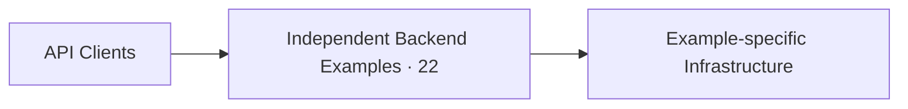

# mall-learning Repository Study

[All studies](../../README.md) · [Backend Engineering](../README.md)

> **Table of Contents**
>
> - [0. Overview](#0-overview)
> - [1. Backend](#1-backend)
> - [2. Engineering Coverage](#2-engineering-coverage)

## 0. Overview

> Companion tutorials and Spring Boot examples for mall.

> - Source: [macrozheng/mall-learning](https://github.com/macrozheng/mall-learning).
> - Revision: `master` at [`cd02c00`](https://github.com/macrozheng/mall-learning/commit/cd02c000e57c693e49f1f72986dbfa6e4c952e09).
> - Depth: Low.
> - Status: Complete.

1. Frontend
   - Commerce interfaces live in external repositories.
2. [Backend](#1-backend): 22 independent example applications.
   - Root build: 20 modules.
   - Additional examples: `mall-tiny-alipay` and `mall-tiny-jenkins`.
3. Technology stack
   - Application foundation

     <table>
       <tbody>
         <tr><td>Java 8</td><td></td></tr>
         <tr><td>Spring Boot 2.7.5</td><td></td></tr>
         <tr><td>MyBatis 3.5.10 · Starter 2.2.2</td><td></td></tr>
         <tr><td>MyBatis Generator 1.4.1</td><td></td></tr>
         <tr><td>MyBatis-Plus 3.5.3</td><td><code>mall-tiny-plus</code> only.</td></tr>
         <tr><td>PageHelper Starter 1.4.5 · Druid 1.2.14</td><td></td></tr>
         <tr><td>Springfox 3.0.0</td><td></td></tr>
         <tr><td>Spring Security · JJWT 0.9.1 · BCrypt</td><td></td></tr>
       </tbody>
     </table>

   - Data and messaging

     <table>
       <tbody>
         <tr><td>MySQL 5.7</td><td>One server; <code>mall_tiny</code> schema.</td></tr>
         <tr><td>Redis</td><td>One endpoint; no cluster or Sentinel.</td></tr>
         <tr><td>Elasticsearch</td><td>One endpoint; server version unpinned.</td></tr>
         <tr><td>MongoDB</td><td>One endpoint; <code>mall-port</code> database.</td></tr>
         <tr><td>RabbitMQ</td><td>TTL and dead-letter cancellation examples.</td></tr>
       </tbody>
     </table>

   - Integrations and deployment

     <table>
       <tbody>
         <tr><td>MinIO SDK 8.4.5</td><td></td></tr>
         <tr><td>Alipay SDK 4.38.72.ALL</td><td></td></tr>
         <tr><td>Docker · Docker Compose</td><td>One application and one MySQL container.</td></tr>
         <tr><td>Jenkins</td><td></td></tr>
       </tbody>
     </table>

4. Setup
   - Schema: `document/sql/mall_tiny.sql`.
   - Build example: `mvn -pl mall-tiny-01 -am package`.
5. [Engineering Coverage](#2-engineering-coverage).

## 1. Backend

> 22 independent example applications.

- Counts: mapped controller methods, including repeated examples.

| Component | API endpoints | Purpose |
| --- | ---: | --- |
| `mall-tiny-01` | 6 | Boot and MyBatis. |
| `mall-tiny-02` | 6 | Adds Swagger. |
| `mall-tiny-03` | 8 | Adds Redis verification codes. |
| `mall-tiny-04` | 10 | Adds JWT authentication. |
| `mall-tiny-05` | 15 | Adds Elasticsearch. |
| `mall-tiny-06` | 18 | Adds MongoDB reading history. |
| `mall-tiny-07` | 19 | Adds delayed messaging. |
| `mall-tiny-08` | 21 | Adds MinIO. |
| `mall-tiny` | 21 | Combined example. |
| `mall-tiny-boot` | 7 | Boot configuration. |
| `mall-tiny-mybatis` | 0 | MyBatis. |
| `mall-tiny-generator` | 12 | Generated persistence and CRUD. |
| `mall-tiny-lombok` | 0 | Lombok. |
| `mall-tiny-hutool` | 17 | Hutool utilities. |
| `mall-tiny-swagger` | 7 | API documentation. |
| `mall-tiny-redis` | 10 | Redis and brand caching. |
| `mall-tiny-rabbit` | 5 | Messaging patterns. |
| `mall-tiny-stream` | 7 | Streams and menu trees. |
| `mall-tiny-plus` | 6 | MyBatis-Plus. |
| `mall-tiny-docker` | 6 | Container deployment. |
| Root subtotal | 201 | 20 modules. |
| `mall-tiny-alipay` | 12 | Alipay integration. |
| `mall-tiny-jenkins` | 6 | Automated deployment. |
| Total | 219 | 22 applications. |

## 2. Engineering Coverage

> ✅ Covered · 🟡 Limited · ❌ Not covered · ❓ Unknown.

<table>
  <thead>
    <tr><th>L1 area</th><th>L2 area</th><th>Status</th></tr>
  </thead>
  <tbody>
    <tr><td rowspan="9">Caching</td><td>Basic cache usage</td><td>✅</td></tr>
    <tr><td>Redis cluster</td><td>❌</td></tr>
    <tr><td>Redis Sentinel</td><td>❌</td></tr>
    <tr><td>Redis server tuning</td><td>❌</td></tr>
    <tr><td>Cache penetration protection</td><td>❌</td></tr>
    <tr><td>Cache breakdown protection</td><td>❌</td></tr>
    <tr><td>Cache avalanche protection</td><td>❌</td></tr>
    <tr><td>Cache pollution control</td><td>❌</td></tr>
    <tr><td>Database-cache consistency</td><td>🟡</td></tr>
    <tr><td rowspan="4">Database scaling</td><td>Database cluster</td><td>❌</td></tr>
    <tr><td>Replicas</td><td>❌</td></tr>
    <tr><td>Sharding</td><td>❌</td></tr>
    <tr><td>Read/write splitting</td><td>❌</td></tr>
    <tr><td rowspan="4">Distributed locking</td><td>Distributed lock</td><td>❌</td></tr>
    <tr><td>Ownership-safe release</td><td>❌</td></tr>
    <tr><td>Lease renewal</td><td>❌</td></tr>
    <tr><td>Redlock quorum</td><td>❌</td></tr>
    <tr><td rowspan="6">Concurrency</td><td>Application-managed threads</td><td>❌</td></tr>
    <tr><td>Custom thread pool</td><td>❌</td></tr>
    <tr><td><code>CompletableFuture</code></td><td>❌</td></tr>
    <tr><td>JVM synchronization and locks</td><td>❌</td></tr>
    <tr><td>Atomic classes or CAS</td><td>❌</td></tr>
    <tr><td>Thread-local state</td><td>❌</td></tr>
    <tr><td rowspan="3">Asynchronous processing</td><td>Application async executor</td><td>❌</td></tr>
    <tr><td>Scheduled background jobs</td><td>❌</td></tr>
    <tr><td>External asynchronous callbacks</td><td>✅</td></tr>
    <tr><td rowspan="5">Traffic handling</td><td>Spike-traffic strategy</td><td>🟡</td></tr>
    <tr><td>Rate limiting</td><td>❌</td></tr>
    <tr><td>Circuit breaker</td><td>❌</td></tr>
    <tr><td>Load testing</td><td>❌</td></tr>
    <tr><td>Stated capacity</td><td>❌</td></tr>
  </tbody>
</table>
