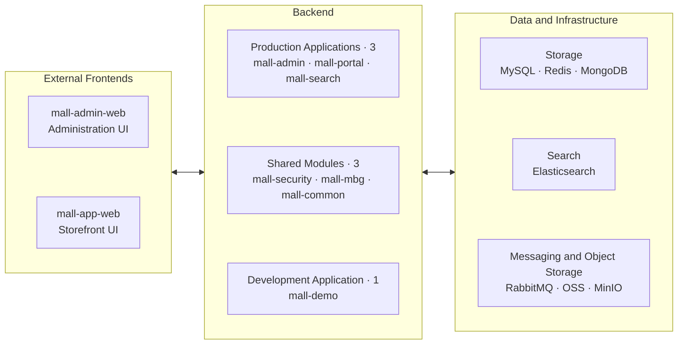

# mall Repository Study

[All studies](../../README.md) · [Backend Engineering](../README.md)

> **Table of Contents**
>
> - [0. Overview](#0-overview)
> - [1. Backend](#1-backend)
> - [2. Engineering Coverage](#2-engineering-coverage)

## 0. Overview

> A mature Spring Boot commerce backend with separate administration, storefront, and search APIs and extensive Chinese documentation.

> - Source: [macrozheng/mall](https://github.com/macrozheng/mall).
> - Revision: `master` at [`dcaa93b`](https://github.com/macrozheng/mall/commit/dcaa93b3150352e5044708d7211b5bed0af4509f).
> - Depth: Low.
> - Status: Complete.
> - Repository boundary: The administration and storefront frontends are maintained separately in `mall-admin-web` and `mall-app-web`.

1. Frontend
   - Administration interface: [`mall-admin-web`](https://github.com/macrozheng/mall-admin-web) is a separate Vue application that uses `mall-admin`.
   - Customer storefront: [`mall-app-web`](https://github.com/macrozheng/mall-app-web) is a separate mobile-oriented Vue application that uses the customer and search APIs.
2. [Backend](#1-backend): Provides independently runnable APIs and shared implementation modules.
   1. Runtime applications
      - `mall-admin`: Runs administration workflows for products, orders, promotions, members, content, and permissions.
      - `mall-portal`: Runs customer workflows for discovery, carts, orders, membership, coupons, and payment.
      - `mall-search`: Imports product data into Elasticsearch and provides product search.
   2. Shared modules
      - `mall-security`: Provides the reusable Spring Security and JWT authentication foundation.
      - `mall-mbg`: Provides generated MyBatis models and mappers for the shared MySQL schema.
      - `mall-common`: Provides shared API responses, configuration, exceptions, logging, services, and utilities.
   3. Development application
      - `mall-demo`: Demonstrates framework configuration and API implementation patterns; it is not part of the production commerce surface.
3. [Security](02-spring-security-integration.md)
   - Spring Security is the repository's only security framework.
   - JWT and BCrypt support Spring Security; they are not separate security systems.

   | Application | Security |
   | --- | --- |
   | `mall-admin` | Spring Security with JWT and resource authorization. |
   | `mall-portal` | Spring Security with JWT and authenticated-only access. |
   | `mall-search` | No application security configuration. |
   | `mall-demo` | Spring Security with all requests permitted. |
4. Technology stack
   - Application foundation

     <table>
       <tbody>
         <tr><td>Java 17</td></tr>
         <tr><td>Spring Boot 3.5.14</td></tr>
         <tr><td><a href="02-spring-security-integration.md">Spring Security</a></td></tr>
         <tr><td>JWT</td></tr>
         <tr><td>BCrypt</td></tr>
         <tr><td>MyBatis 3.5.19</td></tr>
         <tr><td>MyBatis Generator 1.4.2</td></tr>
         <tr><td>PageHelper 6.1.1</td></tr>
         <tr><td>SpringDoc OpenAPI 2.8.17</td></tr>
       </tbody>
     </table>

   - Data and messaging infrastructure

     <table>
       <tbody>
         <tr><td><a href="database/01-mysql.md">MySQL 5.7</a></td><td>One standalone server and one shared <code>mall</code> schema; no cluster, replicas, sharding, or read/write splitting.</td></tr>
         <tr><td><a href="01-redis-integration.md">Redis 7</a></td><td>One standalone server with AOF persistence; no cluster or Sentinel.</td></tr>
         <tr><td>Elasticsearch 7.17.3</td><td>One standalone node; the product index has one shard and zero replicas.</td></tr>
         <tr><td><a href="database/02-mongodb.md">MongoDB 4</a></td><td>One standalone server used only by the portal application.</td></tr>
         <tr><td>RabbitMQ 3.9.11</td><td>One standalone broker used for delayed order cancellation.</td></tr>
       </tbody>
     </table>

   - Logging and observability

     <table>
       <tbody>
         <tr><td>Logstash Logback Encoder 8.0</td><td>TCP JSON logging is optional and controlled by configuration.</td></tr>
         <tr><td>Logstash 7.17.3</td><td>One provided container receives the application log streams.</td></tr>
         <tr><td>Kibana 7.17.3</td><td>One provided container reads from the same Elasticsearch node.</td></tr>
       </tbody>
     </table>

   - External integrations and deployment

     <table>
       <tbody>
         <tr><td>Aliyun OSS SDK 3.18.5</td><td>External object-storage option.</td></tr>
         <tr><td>MinIO SDK 8.6.0</td><td>Local object-storage alternative with one provided server container.</td></tr>
         <tr><td>Alipay SDK 4.40.630.ALL</td><td>Portal payment flow includes return and asynchronous notification callbacks.</td></tr>
         <tr><td>Nginx 1.22</td><td>One provided reverse-proxy container.</td></tr>
         <tr><td>Docker</td><td>Each production application has its own image definition.</td></tr>
         <tr><td>Docker Compose</td><td>Separate application and infrastructure files define one container per declared service.</td></tr>
       </tbody>
     </table>
5. [Engineering Coverage](#2-engineering-coverage): Checks the repository against fixed engineering topics using ✅ Covered, 🟡 Limited, ❌ Not covered, and ❓ Unknown.

## 1. Backend

> Provides independently runnable APIs and shared implementation modules.

| Module | Kind | API Endpoints | Purpose |
| --- | --- | ---: | --- |
| `mall-admin` | Production application | 160 | Administration APIs for the commerce platform. |
| `mall-portal` | Production application | 65 | Customer-facing commerce APIs. |
| `mall-search` | Production application | 8 | Elasticsearch product indexing and search APIs. |
| `mall-demo` | Development application | 13 | Framework and implementation examples. |
| `mall-security` | Shared library | 0 | Reusable authentication and authorization infrastructure. |
| `mall-mbg` | Shared library | 0 | Generated MyBatis persistence code for the MySQL schema. |
| `mall-common` | Shared library | 0 | Common web, configuration, error-handling, logging, and utility code. |
| Total | 4 applications and 3 libraries | 246 | Complete backend module set. |

## 2. Engineering Coverage

> Checks the repository against fixed engineering topics using ✅ Covered, 🟡 Limited, ❌ Not covered, and ❓ Unknown.

<table>
  <thead>
    <tr><th>L1 area</th><th>L2 area</th><th>Status</th></tr>
  </thead>
  <tbody>
    <tr><td rowspan="9"><a href="01-redis-integration.md">Caching</a></td><td>Basic cache usage</td><td>✅</td></tr>
    <tr><td>Redis cluster</td><td>❌</td></tr>
    <tr><td>Redis Sentinel</td><td>❌</td></tr>
    <tr><td>Redis server tuning</td><td>❌</td></tr>
    <tr><td>Cache penetration protection</td><td>❌</td></tr>
    <tr><td>Cache breakdown protection</td><td>❌</td></tr>
    <tr><td>Cache avalanche protection</td><td>❌</td></tr>
    <tr><td>Cache pollution control</td><td>❌</td></tr>
    <tr><td>Database-cache consistency</td><td>❌</td></tr>
    <tr><td rowspan="4">Database scaling</td><td>Database cluster</td><td>❌</td></tr>
    <tr><td>Replicas</td><td>❌</td></tr>
    <tr><td>Sharding</td><td>❌</td></tr>
    <tr><td>Read/write splitting</td><td>❌</td></tr>
    <tr><td rowspan="4">Distributed locking</td><td>Distributed lock</td><td>❌</td></tr>
    <tr><td>Ownership-safe release</td><td>❌</td></tr>
    <tr><td>Lease renewal</td><td>❌</td></tr>
    <tr><td>Redlock quorum</td><td>❌</td></tr>
    <tr><td rowspan="6">Concurrency</td><td>Application-managed threads</td><td>❌</td></tr>
    <tr><td>Custom thread pool</td><td>❌</td></tr>
    <tr><td><code>CompletableFuture</code></td><td>❌</td></tr>
    <tr><td>JVM synchronization and locks</td><td>❌</td></tr>
    <tr><td>Atomic classes or CAS</td><td>❌</td></tr>
    <tr><td>Thread-local state</td><td>❌</td></tr>
    <tr><td rowspan="3">Asynchronous processing</td><td>Application async executor</td><td>❌</td></tr>
    <tr><td>Scheduled background jobs</td><td>❌</td></tr>
    <tr><td>External asynchronous callbacks</td><td>✅</td></tr>
    <tr><td rowspan="5">Traffic handling</td><td>Spike-traffic strategy</td><td>🟡</td></tr>
    <tr><td>Rate limiting</td><td>❌</td></tr>
    <tr><td>Circuit breaker</td><td>❌</td></tr>
    <tr><td>Load testing</td><td>❌</td></tr>
    <tr><td>Stated capacity</td><td>❌</td></tr>
  </tbody>
</table>
