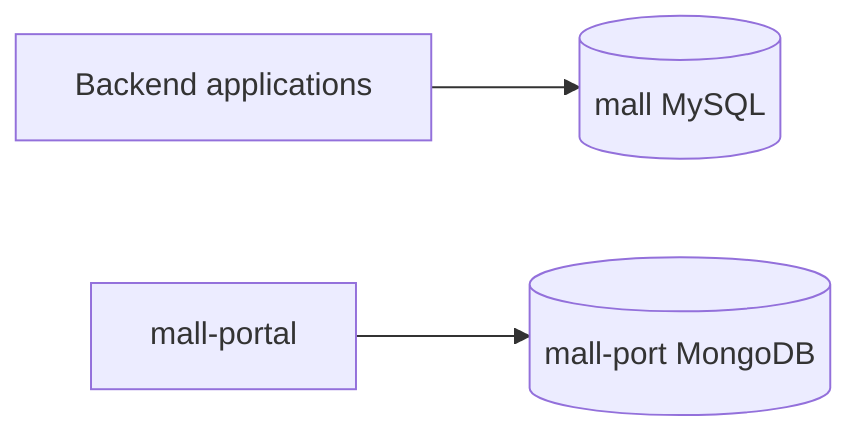

# Database

[All studies](../../../README.md) · [Backend Engineering](../../README.md) · [mall overview](../README.md)

> **Table of Contents**
>
> - [0. Overview](#0-overview)
> - [1. Database Topology](#1-database-topology)

## 0. Overview

> Mall uses one standalone MySQL server for core relational data and one standalone MongoDB server for member-activity documents.

1. [Database Topology](#1-database-topology): MySQL is shared by the backend applications, while MongoDB is used only by `mall-portal`.
2. [MySQL](01-mysql.md): MySQL stores Mall's core commerce and administration data in one `mall` schema containing 76 tables.
3. [MongoDB](02-mongodb.md): MongoDB stores three denormalized member-activity collections used only by `mall-portal`.

## 1. Database Topology

> MySQL is shared by the backend applications, while MongoDB is used only by `mall-portal`.

| Database | Deployment | Main data |
| --- | --- | --- |
| MySQL 5.7 | One standalone server and one `mall` schema | Core commerce and administration data |
| MongoDB 4 | One standalone server and one `mall-port` database | Browsing history, product collections, and brand attention |
