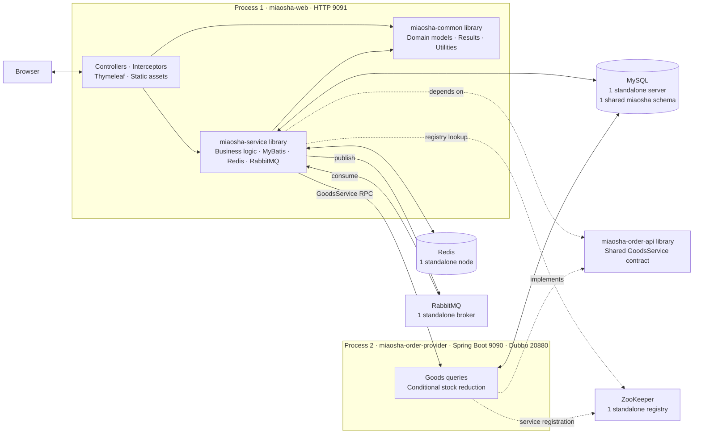

# miaosha v2 Repository Study

[All studies](../../README.md) · [Backend Engineering](../README.md)

> **Table of Contents**
>
> - [0. Overview](#0-overview)
> - [1. Backend](#1-backend)
>   - [1.1 Runtime Components](#11-runtime-components)
>   - [1.2 HTTP Endpoints](#12-http-endpoints)
>   - [1.3 Dubbo RPC Operations](#13-dubbo-rpc-operations)
> - [2. Engineering Coverage](#2-engineering-coverage)

## 0. Overview

> A legacy Spring Boot flash-sale learning system with a web application and a separate Dubbo goods service.

> - Source: [qiurunze123/miaosha](https://github.com/qiurunze123/miaosha).
> - Revision: `master` at [`e580176`](https://github.com/qiurunze123/miaosha/commit/e58017658e549b63fc4db2160d2325ccd7f8435b).
> - Depth: Low.
> - Status: Incomplete.
> - Repository boundary: This study includes `miaosha-v2` and its required `miaosha-order` RPC modules; it excludes `miaosha-v1`, `miaosha-admin`, and the generic `miaosha-rpc` demonstration.

1. Frontend
   - Server-rendered frontend: There is no separate frontend application. Thymeleaf templates and browser assets are packaged inside `miaosha-web` and served by the same process as the HTTP controllers.
2. [Backend](#1-backend)
   - Runtime processes
     - `miaosha-web`: HTTP application containing the web, service, and common modules.
     - `miaosha-order-provider`: Dubbo service for goods queries and stock reduction.
   - Libraries
     - `miaosha-service`: Business implementation packaged into `miaosha-web`.
     - `miaosha-common`: Shared domain models, results, and utilities packaged into `miaosha-web`.
     - `miaosha-order-api`: RPC contract shared by both processes.
3. [User Purchase Flow](02-user-purchase-flow.md): Traces the browser path from account access to the flash-sale result.
4. Technology stack
   - Browser interface

     <table>
       <tbody>
         <tr><td>Thymeleaf</td><td>Renders the browser interface inside <code>miaosha-web</code>; there is no separate frontend application.</td></tr>
         <tr><td>NekoHTML</td><td></td></tr>
         <tr><td>Bootstrap</td><td>Bundled as static assets rather than installed through a frontend build.</td></tr>
         <tr><td>jQuery</td><td>Bundled as static assets rather than installed through a frontend build.</td></tr>
         <tr><td>jQuery Validation and Layer</td><td>Used by the templates for form validation and browser dialogs.</td></tr>
       </tbody>
     </table>

   - Application framework

     <table>
       <tbody>
         <tr><td>Java 8</td><td></td></tr>
         <tr><td>Spring Boot 2.6.1</td><td>Runs the web and goods-service processes; the service and common modules are libraries inside the web process.</td></tr>
         <tr><td>Spring MVC</td><td>Exposes 19 HTTP endpoints from <code>miaosha-web</code>.</td></tr>
         <tr><td>Spring Validation</td><td></td></tr>
         <tr><td>Lombok</td><td></td></tr>
       </tbody>
     </table>

   - Persistence, caching, and serialization

     <table>
       <tbody>
         <tr><td>MyBatis Spring Boot Starter 2.2.0</td><td>Both runtime processes use mapper-based database access.</td></tr>
         <tr><td>MySQL Connector/J</td><td></td></tr>
         <tr><td>Druid 1.2.8</td><td>Each process owns a connection pool to the same database schema.</td></tr>
         <tr><td>MySQL</td><td>One standalone server and one shared <code>miaosha</code> schema; no replicas, sharding, or read/write splitting.</td></tr>
         <tr><td>Redis through Jedis</td><td>One standalone node used only by the web process; no cluster or Sentinel.</td></tr>
         <tr><td>Fastjson 1.2.78</td><td>Used for Redis values and application JSON serialization.</td></tr>
       </tbody>
     </table>

   - Messaging and RPC

     <table>
       <tbody>
         <tr><td>RabbitMQ through Spring AMQP</td><td>One standalone broker; the producer and listener both run inside the web process.</td></tr>
         <tr><td>Dubbo 2.6.9</td><td>Provides synchronous <code>GoodsService</code> RPC between the two processes.</td></tr>
         <tr><td>Dubbo Spring Boot Starter 0.2.1.RELEASE</td><td></td></tr>
         <tr><td>ZooKeeper 3.4.14</td><td>One registry endpoint; no ensemble.</td></tr>
         <tr><td>Curator Framework 5.1.0</td><td></td></tr>
         <tr><td>ZkClient 0.1</td><td></td></tr>
       </tbody>
     </table>

   - Utilities, build, and test

     <table>
       <tbody>
         <tr><td>Apache Commons Codec</td><td>Supports the repository's hashing and Base64 helpers.</td></tr>
         <tr><td>Apache Commons Lang 3</td><td></td></tr>
         <tr><td>Joda-Time 2.10.13</td><td></td></tr>
         <tr><td>Maven</td><td>The root build aggregates the v2 web modules and the separate order-service modules.</td></tr>
         <tr><td>Spring Boot Test</td><td></td></tr>
       </tbody>
     </table>
5. Setup

   | Requirement | Repository setting |
   | --- | --- |
   | Java | JDK 8 source and target compatibility. |
   | Web process | Spring Boot on HTTP port `9091`. |
   | Goods-service process | Spring Boot on HTTP port `9090` and Dubbo port `20880`. |
   | MySQL | One server at `localhost:3306` with schema `miaosha`. |
   | Redis | One configured server endpoint on port `6379`. |
   | RabbitMQ | One configured broker endpoint on port `5672` with virtual host `/`. |
   | ZooKeeper | One registry endpoint at `localhost:2181`. |
6. [Engineering Coverage](#2-engineering-coverage)

## 1. Backend

> The backend consists of one HTTP application and one Dubbo goods service.

1. [Runtime Components](#11-runtime-components): Identifies the processes and libraries that form the backend boundary.
2. [HTTP Endpoints](#12-http-endpoints): Lists every controller endpoint exposed by `miaosha-web`.
3. [Dubbo RPC Operations](#13-dubbo-rpc-operations): Lists the goods-service contract exposed by `miaosha-order-provider`.

### 1.1 Runtime Components

| Component | API endpoints | Purpose |
| --- | ---: | --- |
| `miaosha-web` process | 19 HTTP | Runs the customer-facing application and packages the service and common libraries. |
| `miaosha-order-provider` process | 3 RPC | Provides goods queries and conditional stock reduction. |
| Supporting libraries | 0 runtime endpoints | `miaosha-service`, `miaosha-common`, and `miaosha-order-api`. |
| Total | 19 HTTP and 3 RPC | Two runtime processes. |

### 1.2 HTTP Endpoints

> `ANY` means the `@RequestMapping` does not restrict the HTTP method.

1. Page-rendering endpoints

   <table>
     <thead>
       <tr><th>Controller</th><th>Method</th><th>Endpoint</th><th>Function</th></tr>
     </thead>
     <tbody>
       <tr><td rowspan="2">Registration</td><td><code>ANY</code></td><td><code>/do_login</code></td><td>Renders the primary login page.</td></tr>
       <tr><td><code>ANY</code></td><td><code>/registerv2</code></td><td>Renders the registration page.</td></tr>
       <tr><td rowspan="2">Login</td><td><code>ANY</code></td><td><code>/login/sayHello</code></td><td>Renders an alternate login page.</td></tr>
       <tr><td><code>ANY</code></td><td><code>/login/to_login</code></td><td>Increments the Redis visitor counter and renders the login page.</td></tr>
       <tr><td rowspan="2">Goods</td><td><code>ANY</code></td><td><code>/goods/to_list</code></td><td>Fetches products through Dubbo, then returns cached or newly rendered HTML.</td></tr>
       <tr><td><code>ANY</code></td><td><code>/goods/to_detail2/{goodsId}</code></td><td>Returns cached HTML or fetches product details, calculates sale status, renders the page, and caches it.</td></tr>
       <tr><td>Message</td><td><code>ANY</code></td><td><code>/message/list</code></td><td>Renders the message-list page; its data query is disabled.</td></tr>
     </tbody>
   </table>
2. Action and data endpoints

   <table>
     <thead>
       <tr><th>Controller</th><th>Method</th><th>Endpoint</th><th>Function</th></tr>
     </thead>
     <tbody>
       <tr><td rowspan="2">Registration</td><td><code>ANY</code></td><td><code>/checkUsername</code></td><td>Reports whether a username is available.</td></tr>
       <tr><td><code>ANY</code></td><td><code>/register</code></td><td>Registers a user account.</td></tr>
       <tr><td rowspan="2">Login</td><td><code>ANY</code></td><td><code>/login/loginin</code></td><td>Authenticates credentials and creates the token cookie.</td></tr>
       <tr><td><code>ANY</code></td><td><code>/login/create_token</code></td><td>Authenticates credentials and returns a token.</td></tr>
       <tr><td>Goods</td><td><code>ANY</code></td><td><code>/goods/detail/{goodsId}</code></td><td>Returns product, user, and sale-status data.</td></tr>
       <tr><td rowspan="5">Flash sale</td><td><code>POST</code></td><td><code>/miaosha/{path}/do_miaosha</code></td><td>Validates and admits a purchase request into RabbitMQ.</td></tr>
       <tr><td><code>GET</code></td><td><code>/miaosha/result</code></td><td>Returns the order ID, pending state, or sold-out result.</td></tr>
       <tr><td><code>GET</code></td><td><code>/miaosha/path</code></td><td>Validates the CAPTCHA and returns a temporary purchase path.</td></tr>
       <tr><td><code>GET</code></td><td><code>/miaosha/verifyCodeRegister</code></td><td>Generates the registration arithmetic CAPTCHA image.</td></tr>
       <tr><td><code>GET</code></td><td><code>/miaosha/verifyCode</code></td><td>Generates a product-specific purchase CAPTCHA image.</td></tr>
       <tr><td>Order</td><td><code>ANY</code></td><td><code>/order/detail</code></td><td>Returns an order and its product details.</td></tr>
       <tr><td>Message</td><td><code>ANY</code></td><td><code>/message/getNewMessage</code></td><td>Placeholder message check that currently returns an empty string.</td></tr>
     </tbody>
   </table>

### 1.3 Dubbo RPC Operations

| Service | Operation | Function |
| --- | --- | --- |
| `GoodsService` | `listGoodsVo()` | Returns all flash-sale products. |
| `GoodsService` | `getGoodsVoByGoodsId(long goodsId)` | Returns one flash-sale product by identifier. |
| `GoodsService` | `reduceStock(GoodsVoOrder goods)` | Conditionally decrements database stock and reports success. |

## 2. Engineering Coverage

> Uses ✅ Covered, 🟡 Limited, ❌ Not covered, and ❓ Unknown to evaluate specific engineering capabilities.
>
> Commented examples and unused helpers count as limited at most; repository notes do not count as active runtime behavior.

<table>
  <thead>
    <tr><th>L1 area</th><th>L2 area</th><th>Status</th></tr>
  </thead>
  <tbody>
    <tr><td rowspan="9">Caching</td><td>Basic cache usage</td><td>✅</td></tr>
    <tr><td>Redis cluster</td><td>❌</td></tr>
    <tr><td>Redis Sentinel</td><td>❌</td></tr>
    <tr><td>Redis server tuning</td><td>❌</td></tr>
    <tr><td>Cache penetration protection</td><td>❌</td></tr>
    <tr><td>Cache breakdown protection</td><td>❌</td></tr>
    <tr><td>Cache avalanche protection</td><td>❌</td></tr>
    <tr><td>Cache pollution control</td><td>❌</td></tr>
    <tr><td>Database-cache consistency</td><td>🟡</td></tr>
    <tr><td rowspan="4">Database scaling</td><td>Database cluster</td><td>❌</td></tr>
    <tr><td>Replicas</td><td>❌</td></tr>
    <tr><td>Sharding</td><td>❌</td></tr>
    <tr><td>Read/write splitting</td><td>❌</td></tr>
    <tr><td rowspan="4">Distributed locking</td><td>Distributed lock</td><td>🟡</td></tr>
    <tr><td>Ownership-safe release</td><td>🟡</td></tr>
    <tr><td>Lease renewal</td><td>❌</td></tr>
    <tr><td>Redlock quorum</td><td>❌</td></tr>
    <tr><td rowspan="6">Concurrency</td><td>Application-managed threads</td><td>❌</td></tr>
    <tr><td>Custom thread pool</td><td>❌</td></tr>
    <tr><td><code>CompletableFuture</code></td><td>❌</td></tr>
    <tr><td>JVM synchronization and locks</td><td>🟡</td></tr>
    <tr><td>Atomic classes or CAS</td><td>❌</td></tr>
    <tr><td>Thread-local state</td><td>✅</td></tr>
    <tr><td rowspan="3">Asynchronous processing</td><td>Application async executor</td><td>❌</td></tr>
    <tr><td>Scheduled background jobs</td><td>❌</td></tr>
    <tr><td>External asynchronous callbacks</td><td>❌</td></tr>
    <tr><td rowspan="5">Traffic handling</td><td>Spike-traffic strategy</td><td>✅</td></tr>
    <tr><td>Rate limiting</td><td>✅</td></tr>
    <tr><td>Circuit breaker</td><td>❌</td></tr>
    <tr><td>Load testing</td><td>🟡</td></tr>
    <tr><td>Stated capacity</td><td>🟡</td></tr>
  </tbody>
</table>
