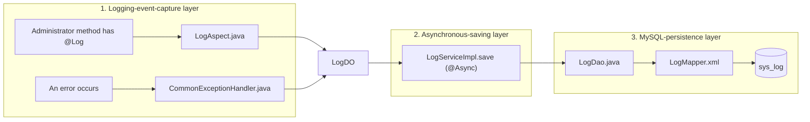

# Admin Audit Logging

[All studies](../../README.md) · [Backend Engineering](../README.md) · [novel-plus overview](README.md)

> **Table of Contents**
>
> - [0. Overview](#0-overview)
> - [1. How It Is Built](#1-how-it-is-built)
> - [2. How It Runs](#2-how-it-runs)

## 0. Overview

> Admin audit logging has four layers: logging data, logging-event capture, asynchronous saving, and MySQL persistence.

## 1. How It Is Built

1. Build the logging-data layer
   1. Create the logging marker: `Log.java`
   2. Create the log-record model: `LogDO.java`
2. Build the logging-event-capture layer
   1. Capture annotated operations: `LogAspect.java`
      - Detects `@Log`, creates `LogDO`, and calls `LogService`.
   2. Capture handled errors: `CommonExceptionHandler.java`
      - Creates `LogDO` and calls `LogService`.
   3. Apply the logging marker by adding `@Log` to the method.
3. Build the asynchronous-saving layer
   1. Create the asynchronous-saving service: `LogService.java`, `LogServiceImpl.java`
   2. Enable background execution: `SpringAsyncConfig.java`
      - Uses `@EnableAsync` to activate Spring's `@Async` support.
      - Its custom executor is commented out, so this mechanism does not use the `novel-front` shared thread pool.
4. Build the MySQL-persistence layer
   1. Create database access: `LogDao.java`
   2. Create the insert mapping: `LogMapper.xml`
   3. Create the log table: `sys_log`

## 2. How It Runs

