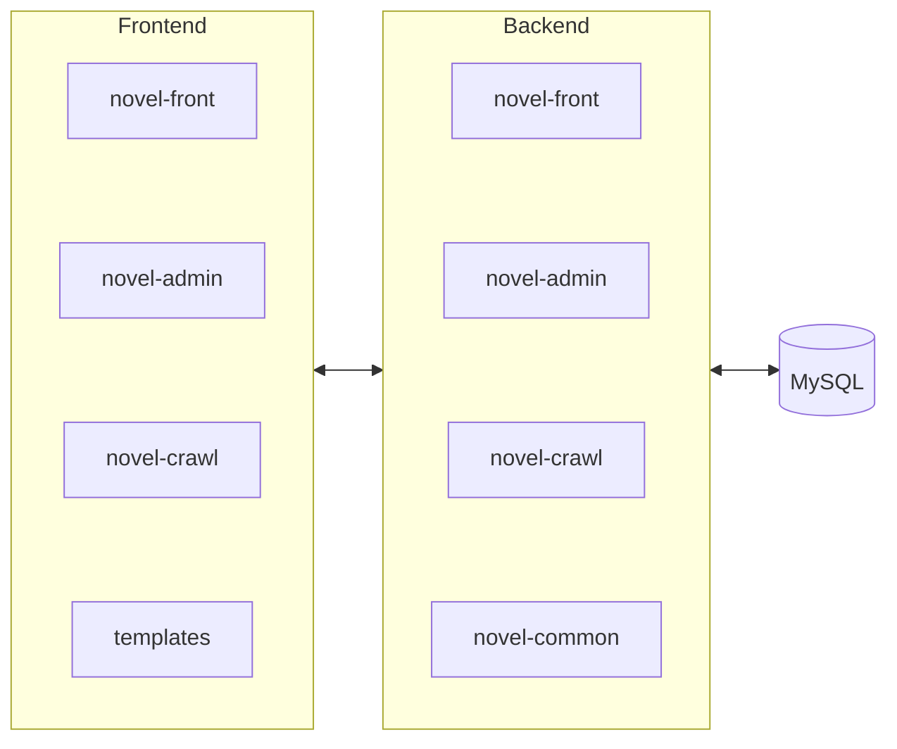

# novel-plus Repository Study

[All studies](../../README.md) · [Backend Engineering](../README.md)

> **Table of Contents**
>
> - [0. Overview](#0-overview)
> - [1. Backend](#1-backend)
> - [2. Engineering Coverage](#2-engineering-coverage)

## 0. Overview

> An online literature CMS with reader and author interfaces, administration, and content crawling.

> - Source: [201206030/novel-plus](https://github.com/201206030/novel-plus).
> - Revision: `develop_xxy` at [`875f620`](https://github.com/201206030/novel-plus/commit/875f620e5c678eac2173d3e8b8e68b4343342374).
> - Depth: High.
> - Status: Complete.



1. Frontend
   - Reader and author interface: Packaged inside `novel-front`.
   - Platform administration interface: Packaged inside `novel-admin`.
   - Crawler management interface: Packaged inside `novel-crawl`.
   - Website themes: Stored in `templates`.
2. [Backend](#1-backend): Provides the server-side applications and shared code.
   - `novel-front` → `FrontNovelApplication`: Runs the reader and author features.
   - `novel-admin` → `AdminApplication`: Runs the platform-management features.
   - `novel-crawl` → `CrawlNovelApplication`: Collects and updates novel content.
   - `novel-common` → No application: Provides shared backend code for `novel-front` and `novel-crawl`.
3. Technology stack
   - Application foundation

     <table>
       <tbody>
         <tr><td>Java</td><td>Java 21 is the shared language and runtime baseline.</td></tr>
         <tr><td>Spring Boot</td><td>Version 3.4.0 runs <code>novel-front</code> and <code>novel-crawl</code>; <code>novel-admin</code> remains on 2.7.18.</td></tr>
         <tr><td><a href="database/01-mybatis-data-access.md">MyBatis stack</a></td><td>MyBatis Starter 3.0.4, Dynamic SQL 1.5.0, and Generator 1.4.0 support the repository's Java DSL and XML mapper paths.</td></tr>
         <tr><td>PageHelper</td><td>Version 1.4.6 provides pagination for MyBatis list queries.</td></tr>
       </tbody>
     </table>

   - Security

     - Novel Plus has three separate security systems, one for each application.
     - In theory, all three could use Spring Security.
     - The repository does not state the reason; the mixed stack likely reflects modules developed or migrated separately.

     <table>
       <tbody>
         <tr><td>JJWT</td><td><code>novel-front</code> implements custom JWT authentication for readers and authors.</td></tr>
         <tr><td>Apache Shiro</td><td><code>novel-admin</code> uses Shiro authentication, authorization, and Redis-backed sessions.</td></tr>
         <tr><td>Spring Security</td><td><code>novel-crawl</code> protects its management interface with one configured administrator.</td></tr>
       </tbody>
     </table>

   - Data and storage infrastructure

     <table>
       <tbody>
         <tr><td><a href="database/README.md">MySQL</a></td><td>One configured datasource and one <code>novel_plus</code> schema contain 40 logical tables.</td></tr>
         <tr><td>ShardingSphere-JDBC</td><td>Version 5.5.1 routes <code>book_content</code> across ten physical tables inside the same database.</td></tr>
         <tr><td><a href="01-redis-integration.md">Redis</a></td><td>Each application profile connects to one Redis endpoint; cluster, Sentinel, and server settings are not defined.</td></tr>
         <tr><td>Local filesystem</td><td>Chapter content and uploaded images can be stored outside MySQL on local paths.</td></tr>
       </tbody>
     </table>

   - Web, external integrations, and deployment

     <table>
       <tbody>
         <tr><td>Thymeleaf and Layui</td><td>The three applications package their server-rendered interfaces inside the repository.</td></tr>
         <tr><td>Spring AI</td><td><code>novel-front</code> uses OpenAI-compatible chat and image models for author tools and cover generation.</td></tr>
         <tr><td>Aliyun OSS</td><td><code>novel-front</code> can store uploaded images in external object storage.</td></tr>
         <tr><td>Alipay SDK</td><td><code>novel-front</code> integrates payment submission and notification callbacks.</td></tr>
         <tr><td>Docker</td><td>Each executable application provides its own Dockerfile; no Docker Compose topology is included.</td></tr>
       </tbody>
     </table>

4. Features
   - [Flows](flows/README.md): Traces complete user actions through the repository.
     - [Book Download](flows/01-book-download.md): Streams one novel from MySQL to an administrator as a `.txt` response; Redis stores only a temporary lock for that book ID.
     - [Homepage Book-Setting Cache](flows/02-homepage-book-setting-cache.md): Loads homepage book settings through Redis; a cache miss loads MySQL and caches the result for 24 hours.
     - [Comment Like Toggle](flows/03-comment-like-toggle.md): Uses Redis as the only store for comment likes; the Set has no expiry.
     - [Registration CAPTCHA](flows/04-registration-captcha.md): Stores the generated CAPTCHA text in Redis by client IP for five minutes, then compares it with the submitted CAPTCHA text during registration.
     - [AI Cover Generation](flows/05-ai-cover-generation.md): The add-book request returns before the AI cover is ready. Redis temporarily passes the finished cover URL from the background task to the polling author page.
   - [Concurrency and Locking](concurrency-and-locking/README.md)
   - [Admin Audit Logging](03-admin-audit-logging.md): Has four layers: logging data, logging-event capture, asynchronous saving, and MySQL persistence.

5. Setup

   | Requirement | Repository setting |
   | --- | --- |
   | Java | JDK 21 |
   | Build tool | Apache Maven |
   | Maven version | Not pinned; the repository has no Maven Wrapper. |
   | Spring Boot | 3.4.0 for <code>novel-front</code> and <code>novel-crawl</code>; 2.7.18 for <code>novel-admin</code> |
   | Project version | 5.3.3 |
   | Build entry point | Root <code>pom.xml</code> |
   | Built modules | <code>novel-common</code>, <code>novel-front</code>, <code>novel-crawl</code>, and <code>novel-admin</code> |

   ```shell
   mvn clean package
   ```

6. [Engineering Coverage](#2-engineering-coverage)

## 1. Backend

> Provides the server-side applications and shared code.

| Module | Page-rendering routes | Functional endpoints | Total |
| --- | ---: | ---: | ---: |
| `novel-front` | 19 | 66 | 85 |
| `novel-admin` | 85 | 151 | 236 |
| `novel-crawl` | 4 | 10 | 14 |
| `novel-common` | 0 | 0 | 0 |
| Total | 108 | 227 | 335 |

## 2. Engineering Coverage

> Checks the repository against fixed engineering topics using ✅ Covered, 🟡 Limited, ❌ Not covered, and ❓ Unknown.

<table>
  <thead>
    <tr><th>L1 area</th><th>L2 area</th><th>Status</th></tr>
  </thead>
  <tbody>
    <tr><td rowspan="9">Caching</td><td>Basic cache usage</td><td>✅</td></tr>
    <tr><td>Redis cluster</td><td>❌</td></tr>
    <tr><td>Redis Sentinel</td><td>❌</td></tr>
    <tr><td>Redis server tuning</td><td>❌</td></tr>
    <tr><td>Cache penetration protection</td><td>❌</td></tr>
    <tr><td>Cache breakdown protection</td><td>❌</td></tr>
    <tr><td>Cache avalanche protection</td><td>❌</td></tr>
    <tr><td>Cache pollution control</td><td>❌</td></tr>
    <tr><td>Database-cache consistency</td><td>🟡</td></tr>
    <tr><td rowspan="4">Database scaling</td><td>Database cluster</td><td>❌</td></tr>
    <tr><td>Replicas</td><td>❌</td></tr>
    <tr><td>Sharding</td><td>✅</td></tr>
    <tr><td>Read/write splitting</td><td>❌</td></tr>
    <tr><td rowspan="4">Distributed locking</td><td>Distributed lock</td><td>✅</td></tr>
    <tr><td>Ownership-safe release</td><td>❌</td></tr>
    <tr><td>Lease renewal</td><td>❌</td></tr>
    <tr><td>Redlock quorum</td><td>❌</td></tr>
    <tr><td rowspan="6">Concurrency</td><td>Application-managed threads</td><td>✅</td></tr>
    <tr><td>Custom thread pool</td><td>✅</td></tr>
    <tr><td><code>CompletableFuture</code></td><td>✅</td></tr>
    <tr><td>JVM synchronization and locks</td><td>✅</td></tr>
    <tr><td>Atomic classes or CAS</td><td>✅</td></tr>
    <tr><td>Thread-local state</td><td>✅</td></tr>
    <tr><td rowspan="3">Asynchronous processing</td><td>Application async executor</td><td>✅</td></tr>
    <tr><td>Scheduled background jobs</td><td>✅</td></tr>
    <tr><td>External asynchronous callbacks</td><td>✅</td></tr>
    <tr><td rowspan="5">Traffic handling</td><td>Spike-traffic strategy</td><td>🟡</td></tr>
    <tr><td>Rate limiting</td><td>❌</td></tr>
    <tr><td>Circuit breaker</td><td>❌</td></tr>
    <tr><td>Load testing</td><td>❌</td></tr>
    <tr><td>Stated capacity</td><td>❌</td></tr>
  </tbody>
</table>
