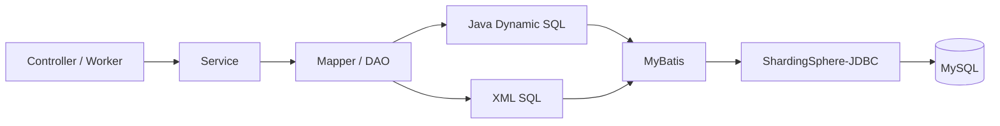

# MyBatis Data Access

[All studies](../../../README.md) · [Backend Engineering](../../README.md) · [novel-plus overview](../README.md)

> **Table of Contents**
>
> - [0. Overview](#0-overview)
> - [1. Configuration](#1-configuration)
> - [2. book_content Example](#2-book_content-example)

## 0. Overview

> MyBatis converts Mapper or DAO method calls into SQL before execution through ShardingSphere-JDBC.



1. SQL styles

   | Style | Structure | Main usage |
   | --- | --- | --- |
   | Java Dynamic SQL | <code>*Mapper</code> + <code>*DynamicSqlSupport</code> | Generated operations used by frontend and crawler |
   | XML SQL | Mapper or DAO interface + <code>*Mapper.xml</code> | Admin operations and custom frontend/crawler queries |

   - Small exception: the admin database generator contains a few SQL annotations such as <code>@Select</code>.

2. [Configuration](#1-configuration): Frontend and crawler share MyBatis settings, while admin keeps separate settings.
3. [book_content Example](#2-book_content-example): The sharded table uses Dynamic SQL in frontend and crawler, but XML SQL in admin.

## 1. Configuration

> Frontend and crawler share MyBatis settings, while admin keeps separate settings.

| Applications | Configuration | Mapper scan | XML location |
| --- | --- | --- | --- |
| <code>novel-front</code><br><code>novel-crawl</code> | <code>novel-common/src/main/resources/application-common.yml</code> | <code>com.java2nb.novel.mapper</code> | <code>classpath*:mybatis/mapping/*.xml</code> |
| <code>novel-admin</code> | <code>novel-admin/src/main/resources/application.yml</code> | <code>com.java2nb.*.dao</code> | <code>mybatis/**/*Mapper.xml</code> |

- Both configurations map database <code>snake_case</code> fields to Java <code>camelCase</code> fields.
- Spring Boot creates the MyBatis infrastructure; the repository does not define a custom global <code>SqlSessionFactory</code>.

## 2. book_content Example

> The sharded table uses Dynamic SQL in frontend and crawler, but XML SQL in admin.

| Application | Data-access path |
| --- | --- |
| Frontend / Crawler | <code>BookContentMapper</code> → Java Dynamic SQL → MyBatis |
| Admin | <code>BookContentDao</code> → <code>BookContentMapper.xml</code> → MyBatis |

```text
Logical SQL:  SELECT ... FROM book_content WHERE index_id = ?
Routing:      index_id % 10
Physical SQL: book_content0 ... book_content9
```

> Complete methods: [Database — Direct SQL](README.md#direct-sql)
