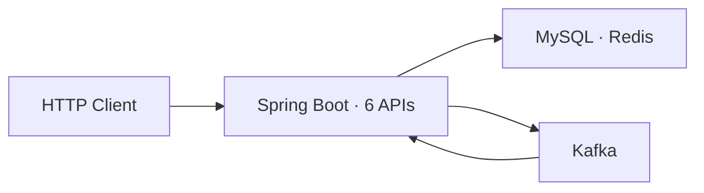

# seconds-kill Repository Study

[All studies](../../README.md) · [Backend Engineering](../README.md)

> **Table of Contents**
>
> - [0. Overview](#0-overview)
> - [1. Backend](#1-backend)
> - [2. Engineering Coverage](#2-engineering-coverage)

## 0. Overview

> A Spring Boot flash-sale experiment with synchronous and Kafka-based order creation.

> - Source: [daydreamdev/seconds-kill](https://github.com/daydreamdev/seconds-kill).
> - Revision: `master` at [`57a31cb`](https://github.com/daydreamdev/seconds-kill/commit/57a31cb2c15b082bc84472b479e17534ee9ace53).
> - Depth: Low.
> - Status: Complete.

1. Frontend
   - None; HTTP endpoints only.
2. [Backend](#1-backend): One application with 6 POST endpoints.
   - Five order variants share one stock model.
   - Optimistic variants use MySQL version checks; Kafka consumption runs inside the application.
3. Technology stack
   - Application foundation

     <table>
       <tbody>
         <tr><td>Java 8</td><td></td></tr>
         <tr><td>Spring Boot 1.5.7.RELEASE</td><td></td></tr>
         <tr><td>MyBatis Starter 1.1.1 · Druid 1.1.0</td><td></td></tr>
       </tbody>
     </table>

   - Data and messaging

     <table>
       <tbody>
         <tr><td>MySQL</td><td>One server; <code>seconds_kill</code> schema.</td></tr>
         <tr><td>Redis · Jedis 2.9.0</td><td>One server; stock cache and Lua limit of 5 requests/s.</td></tr>
         <tr><td>Spring Kafka</td><td>One bootstrap address; 3 listener threads.</td></tr>
       </tbody>
     </table>

4. Setup
   - Runtime: Java 8; Maven 3.6.0 wrapper.
   - Database: README DDL; stock row `id=1` required for startup preheating.
   - Configuration: `application.properties` and hard-coded Redis settings in `RedisPool.java`.
5. [Engineering Coverage](#2-engineering-coverage).

## 1. Backend

> One application with 6 POST endpoints.

| Component | API endpoints | Purpose |
| --- | ---: | --- |
| `seconds-kill` | 6 | Reset state and compare five order variants. |
| Total | 6 | One application; embedded Kafka consumer. |

## 2. Engineering Coverage

> ✅ Covered · 🟡 Limited · ❌ Not covered · ❓ Unknown.

<table>
  <thead>
    <tr><th>L1 area</th><th>L2 area</th><th>Status</th></tr>
  </thead>
  <tbody>
    <tr><td rowspan="9">Caching</td><td>Basic cache usage</td><td>✅</td></tr>
    <tr><td>Redis cluster</td><td>❌</td></tr>
    <tr><td>Redis Sentinel</td><td>❌</td></tr>
    <tr><td>Redis server tuning</td><td>❌</td></tr>
    <tr><td>Cache penetration protection</td><td>❌</td></tr>
    <tr><td>Cache breakdown protection</td><td>❌</td></tr>
    <tr><td>Cache avalanche protection</td><td>❌</td></tr>
    <tr><td>Cache pollution control</td><td>❌</td></tr>
    <tr><td>Database-cache consistency</td><td>🟡</td></tr>
    <tr><td rowspan="4">Database scaling</td><td>Database cluster</td><td>❌</td></tr>
    <tr><td>Replicas</td><td>❌</td></tr>
    <tr><td>Sharding</td><td>❌</td></tr>
    <tr><td>Read/write splitting</td><td>❌</td></tr>
    <tr><td rowspan="4">Distributed locking</td><td>Distributed lock</td><td>❌</td></tr>
    <tr><td>Ownership-safe release</td><td>❌</td></tr>
    <tr><td>Lease renewal</td><td>❌</td></tr>
    <tr><td>Redlock quorum</td><td>❌</td></tr>
    <tr><td rowspan="6">Concurrency</td><td>Application-managed threads</td><td>❌</td></tr>
    <tr><td>Custom thread pool</td><td>🟡</td></tr>
    <tr><td><code>CompletableFuture</code></td><td>❌</td></tr>
    <tr><td>JVM synchronization and locks</td><td>❌</td></tr>
    <tr><td>Atomic classes or CAS</td><td>❌</td></tr>
    <tr><td>Thread-local state</td><td>❌</td></tr>
    <tr><td rowspan="3">Asynchronous processing</td><td>Application async executor</td><td>❌</td></tr>
    <tr><td>Scheduled background jobs</td><td>❌</td></tr>
    <tr><td>External asynchronous callbacks</td><td>❌</td></tr>
    <tr><td rowspan="5">Traffic handling</td><td>Spike-traffic strategy</td><td>✅</td></tr>
    <tr><td>Rate limiting</td><td>✅</td></tr>
    <tr><td>Circuit breaker</td><td>❌</td></tr>
    <tr><td>Load testing</td><td>🟡</td></tr>
    <tr><td>Stated capacity</td><td>❌</td></tr>
  </tbody>
</table>
