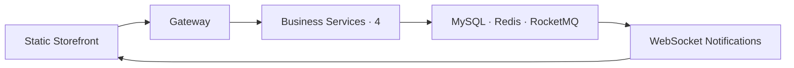

# shop-flashsale_cd05 Repository Study

[All studies](../../README.md) · [Backend Engineering](../README.md)

> **Table of Contents**
>
> - [0. Overview](#0-overview)
> - [1. Backend](#1-backend)
> - [2. Engineering Coverage](#2-engineering-coverage)

## 0. Overview

> A Spring Boot flash-sale system with nine backend applications.

> - Source: [leoen/shop-flashsale_cd05](https://gitee.com/leoen/shop-flashsale_cd05).
> - Revision: `master` at [`e8e7adc`](https://gitee.com/leoen/shop-flashsale_cd05/commit/e8e7adcfdc6642158a834a226356ad505334d357).
> - Depth: Low.
> - Status: Incomplete.

1. Frontend
   - `frontend-server`: HTML and Layui storefront, served by Spring Boot on port 80.
2. [Backend](#1-backend): Nine applications and five shared libraries.
   - Business: products, flash-sale orders, payments, and points.
   - Support: gateway, login, scheduled jobs, WebSocket delivery, and Canal synchronization.
3. Technology stack
   - Application foundation

     <table>
       <tbody>
         <tr><td>Java 8 · Spring Boot 2.3.2.RELEASE</td><td></td></tr>
         <tr><td>Spring Cloud Hoxton.SR8 · Alibaba 2.2.3.RELEASE</td><td>Nacos configuration and discovery.</td></tr>
         <tr><td>MyBatis starter 1.2.0 / 1.3.0 · Druid 1.1.10</td><td></td></tr>
         <tr><td>OpenFeign · Sentinel</td><td>Gateway rules commented out; product fallback is a stub.</td></tr>
         <tr><td>Seata 1.3.0</td><td>Points-payment transaction.</td></tr>
       </tbody>
     </table>

   - Data and coordination

     <table>
       <tbody>
         <tr><td>MySQL</td><td>One configured host; four schemas. SQL dumps use 5.6.36 / 5.7.41.</td></tr>
         <tr><td>Redis · Redisson starter 3.13.5</td><td>One server; 30-minute cache TTL; null caching disabled.</td></tr>
         <tr><td>RocketMQ starter 2.0.4</td><td>Queued orders and delayed payment checks.</td></tr>
         <tr><td>ElasticJob 2.1.5 · ZooKeeper</td><td>Three job shards for sale-session cache initialization.</td></tr>
         <tr><td>Canal starter 1.2.1-RELEASE</td><td>Order changes update Redis asynchronously.</td></tr>
         <tr><td>Alipay SDK 4.10.170.ALL</td><td>Sandbox endpoint and payment callbacks.</td></tr>
       </tbody>
     </table>

4. Setup
   - Build: Java 8 and Maven; import `frontend-server` and `shop-parent` separately.
   - Database scripts: `shop-parent/配置文件/SQL脚本`.
   - Configuration: import the bundled Nacos exports; update bootstrap namespaces, middleware addresses, and payment settings.
   - Export gap: the June 2023 export omits discovery and Canal settings included in the original export.
5. [Engineering Coverage](#2-engineering-coverage).

## 1. Backend

> Nine applications and five shared libraries.

- Counts: mapped HTTP controller methods, including internal APIs and callbacks; excludes Feign declarations and the WebSocket route.
- Performance evidence: comments report 330 → 850 QPS; no test plan or hardware details are bundled.

| Component | HTTP endpoints | Purpose |
| --- | ---: | --- |
| `product-server` | 1 | Product lookup. |
| `seckill-server` | 9 | Flash-sale orders and payment callbacks. |
| `pay-server` | 3 | Alipay operations. |
| `intergral-server` | 2 | Points payments and refunds. |
| `shop-uaa` | 2 | Login and test-user initialization. |
| `api-gateway` | 0 | Routing and request filtering. |
| `job-server` | 0 | Cache initialization and user-cache cleanup. |
| `websocket-server` | 0 | Order-result push through one WebSocket route. |
| `canal-client` | 0 | Order-cache synchronization. |
| `shop-common` | 0 | Shared web infrastructure. |
| Four `*-api` libraries | 0 | Shared domain and message contracts. |
| Total | 17 | Nine applications; five libraries. |

## 2. Engineering Coverage

> ✅ Covered · 🟡 Limited · ❌ Not covered · ❓ Unknown.

<table>
  <thead>
    <tr><th>L1 area</th><th>L2 area</th><th>Status</th></tr>
  </thead>
  <tbody>
    <tr><td rowspan="9">Caching</td><td>Basic cache usage</td><td>✅</td></tr>
    <tr><td>Redis cluster</td><td>❌</td></tr>
    <tr><td>Redis Sentinel</td><td>❌</td></tr>
    <tr><td>Redis server tuning</td><td>❌</td></tr>
    <tr><td>Cache penetration protection</td><td>❌</td></tr>
    <tr><td>Cache breakdown protection</td><td>❌</td></tr>
    <tr><td>Cache avalanche protection</td><td>❌</td></tr>
    <tr><td>Cache pollution control</td><td>🟡</td></tr>
    <tr><td>Database-cache consistency</td><td>🟡</td></tr>
    <tr><td rowspan="4">Database scaling</td><td>Database cluster</td><td>❌</td></tr>
    <tr><td>Replicas</td><td>❌</td></tr>
    <tr><td>Sharding</td><td>❌</td></tr>
    <tr><td>Read/write splitting</td><td>❌</td></tr>
    <tr><td rowspan="4">Distributed locking</td><td>Distributed lock</td><td>❌</td></tr>
    <tr><td>Ownership-safe release</td><td>❌</td></tr>
    <tr><td>Lease renewal</td><td>❌</td></tr>
    <tr><td>Redlock quorum</td><td>❌</td></tr>
    <tr><td rowspan="6">Concurrency</td><td>Application-managed threads</td><td>❌</td></tr>
    <tr><td>Custom thread pool</td><td>❌</td></tr>
    <tr><td><code>CompletableFuture</code></td><td>❌</td></tr>
    <tr><td>JVM synchronization and locks</td><td>✅</td></tr>
    <tr><td>Atomic classes or CAS</td><td>❌</td></tr>
    <tr><td>Thread-local state</td><td>❌</td></tr>
    <tr><td rowspan="3">Asynchronous processing</td><td>Application async executor</td><td>❌</td></tr>
    <tr><td>Scheduled background jobs</td><td>✅</td></tr>
    <tr><td>External asynchronous callbacks</td><td>✅</td></tr>
    <tr><td rowspan="5">Traffic handling</td><td>Spike-traffic strategy</td><td>✅</td></tr>
    <tr><td>Rate limiting</td><td>🟡</td></tr>
    <tr><td>Circuit breaker</td><td>🟡</td></tr>
    <tr><td>Load testing</td><td>🟡</td></tr>
    <tr><td>Stated capacity</td><td>🟡</td></tr>
  </tbody>
</table>
