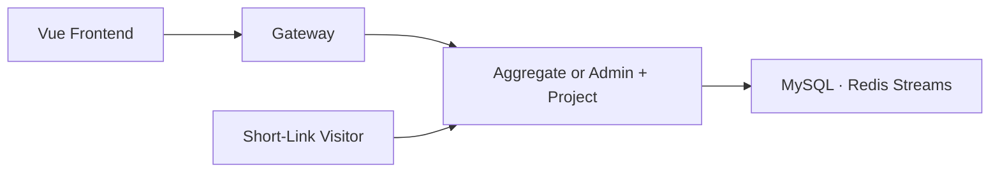

# shortlink Repository Study

[All studies](../../README.md) · [Backend Engineering](../README.md)

> **Table of Contents**
>
> - [0. Overview](#0-overview)
> - [1. Backend](#1-backend)
> - [2. Engineering Coverage](#2-engineering-coverage)

## 0. Overview

> A short-link platform with aggregate and microservice deployment modes.

> - Source: [nageoffer/shortlink](https://github.com/nageoffer/shortlink).
> - Revision: `main` at [`02da298`](https://github.com/nageoffer/shortlink/commit/02da2983c9211928cb473bbbaac67b93f925c138).
> - Depth: High.
> - Status: Incomplete.

1. Frontend
   - `console-vue`: Vue 3 and Element Plus 2.
2. [Backend](#1-backend)
   - Deployment modes (run one at a time)

     | Mode | Gateway | Business applications |
     | --- | --- | --- |
     | Aggregate | `gateway` | `aggregation` (hosts `admin` + `project` together) |
     | Microservice | `gateway` | `admin` `project` |

   - Business modules
     - `admin`: Manages user accounts and short-link groups.
     - `project`: Creates and resolves short links, and records visit statistics.
3. Technology stack
   - Application foundation

     <table>
       <tbody>
         <tr><td>Java 17 · Spring Boot 3.0.7</td><td></td></tr>
         <tr><td>Spring Cloud 2022.0.3 · Alibaba 2022.0.0.0-RC2</td><td>Gateway, Feign, and Nacos discovery.</td></tr>
         <tr><td>MyBatis-Plus 3.5.3.1 · ShardingSphere 5.3.2</td><td>16 table shards per configured logical table.</td></tr>
       </tbody>
     </table>

   - Data and integrations

     <table>
       <tbody>
         <tr><td>MySQL</td><td>One configured server and <code>link</code> schema.</td></tr>
         <tr><td>Redis · Redisson 3.27.2</td><td>One server; Bloom filters, locks, and Streams.</td></tr>
         <tr><td>Sentinel</td><td>Creation limited to 1 QPS; admin Lua filter defaults to 20 requests per second per user.</td></tr>
         <tr><td>AMap</td><td>Visitor-location enrichment.</td></tr>
       </tbody>
     </table>

4. Setup
   - Runtime: Java 17 and Maven.
   - Database: `resources/database`; datasource profiles default to `dev`.
   - Configure redirect domain, AMap access, and local Redis/Nacos endpoints.
5. [Engineering Coverage](#2-engineering-coverage).
6. [Flows](flows/README.md): End-to-end backend flows.
7. [Redis Integration](01-redis-integration.md): Redis configuration and usage in Shortlink.

## 1. Backend

> Four application modules with two deployment modes.

- Counts: mapped controller methods; Feign clients excluded.

| Component | API endpoints | Purpose |
| --- | ---: | --- |
| `gateway` | 0 | Routing and authentication. |
| `aggregation` | 0 | Alternative host for admin and project. |
| `admin` | 26 | Accounts, groups, and management APIs. |
| `project` | 17 | Link creation, redirects, and statistics. |
| Total | 43 | Four application modules. |

## 2. Engineering Coverage

> ✅ Covered · 🟡 Limited · ❌ Not covered · ❓ Unknown.

<table>
  <thead>
    <tr><th>L1 area</th><th>L2 area</th><th>Status</th></tr>
  </thead>
  <tbody>
    <tr><td rowspan="9"><a href="01-redis-integration.md">Caching</a></td><td>Basic cache usage</td><td>✅</td></tr>
    <tr><td>Redis cluster</td><td>❌</td></tr>
    <tr><td>Redis Sentinel</td><td>❌</td></tr>
    <tr><td>Redis server tuning</td><td>❌</td></tr>
    <tr><td>Cache penetration protection</td><td>✅</td></tr>
    <tr><td>Cache breakdown protection</td><td>✅</td></tr>
    <tr><td>Cache avalanche protection</td><td>❌</td></tr>
    <tr><td>Cache pollution control</td><td>❌</td></tr>
    <tr><td>Database-cache consistency</td><td>🟡</td></tr>
    <tr><td rowspan="4">Database scaling</td><td>Database cluster</td><td>❌</td></tr>
    <tr><td>Replicas</td><td>❌</td></tr>
    <tr><td>Sharding</td><td>✅</td></tr>
    <tr><td>Read/write splitting</td><td>❌</td></tr>
    <tr><td rowspan="4">Distributed locking</td><td>Distributed lock</td><td>✅</td></tr>
    <tr><td>Ownership-safe release</td><td>✅</td></tr>
    <tr><td>Lease renewal</td><td>🟡</td></tr>
    <tr><td>Redlock quorum</td><td>❌</td></tr>
    <tr><td rowspan="6">Concurrency</td><td>Application-managed threads</td><td>✅</td></tr>
    <tr><td>Custom thread pool</td><td>✅</td></tr>
    <tr><td><code>CompletableFuture</code></td><td>❌</td></tr>
    <tr><td>JVM synchronization and locks</td><td>❌</td></tr>
    <tr><td>Atomic classes or CAS</td><td>✅</td></tr>
    <tr><td>Thread-local state</td><td>✅</td></tr>
    <tr><td rowspan="3">Asynchronous processing</td><td>Application async executor</td><td>✅</td></tr>
    <tr><td>Scheduled background jobs</td><td>❌</td></tr>
    <tr><td>External asynchronous callbacks</td><td>❌</td></tr>
    <tr><td rowspan="5">Traffic handling</td><td>Spike-traffic strategy</td><td>✅</td></tr>
    <tr><td>Rate limiting</td><td>✅</td></tr>
    <tr><td>Circuit breaker</td><td>❌</td></tr>
    <tr><td>Load testing</td><td>❌</td></tr>
    <tr><td>Stated capacity</td><td>❌</td></tr>
  </tbody>
</table>
