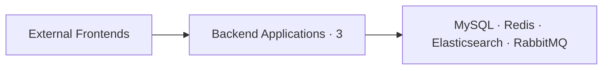

# waynboot-mall Repository Study

[All studies](../../README.md) · [Backend Engineering](../README.md)

> **Table of Contents**
>
> - [0. Overview](#0-overview)
> - [1. Backend](#1-backend)
> - [2. Engineering Coverage](#2-engineering-coverage)

## 0. Overview

> A Spring Boot commerce backend with three applications.

> - Source: [wayn111/waynboot-mall](https://github.com/wayn111/waynboot-mall).
> - Revision: `master` at [`c683afd`](https://github.com/wayn111/waynboot-mall/commit/c683afd8a22c92c298e0258bce134617da3f782d).
> - Depth: High.
> - Status: Incomplete.

1. Frontend
   - External: `waynboot-admin` and `waynboot-mobile`.
2. [Backend](#1-backend): 3 applications and 12 shared libraries.
   - Applications: administration API, mobile API, and message consumer.
   - Libraries: domain implementations and shared infrastructure.
3. Technology stack
   - Application foundation

     <table>
       <tbody>
         <tr><td>Java 17</td><td></td></tr>
         <tr><td>Spring Boot 3.5.14</td><td></td></tr>
         <tr><td>MyBatis-Plus 3.5.16 · Druid 1.2.28</td><td></td></tr>
         <tr><td>Spring Security · JWT · BCrypt</td><td>Administration.</td></tr>
         <tr><td>Sa-Token 1.45.0</td><td>Mobile; Redis sessions.</td></tr>
         <tr><td>Spring Scheduled · ShedLock 5.16.0</td><td>Redis-backed governance-job locks.</td></tr>
       </tbody>
     </table>

   - Data and messaging

     <table>
       <tbody>
         <tr><td>MySQL 8.0.33</td><td>One server; <code>wayn_shop</code> schema.</td></tr>
         <tr><td>Redis 6.2.7</td><td>One server; AOF disabled.</td></tr>
         <tr><td>Elasticsearch 7.14.0</td><td>One node; Java client 7.17.29.</td></tr>
         <tr><td>RabbitMQ 3.12.7</td><td>One broker; delayed-message plugin.</td></tr>
       </tbody>
     </table>

   - Integrations and deployment

     <table>
       <tbody>
         <tr><td>WeChat Pay · Alipay · EPay</td><td></td></tr>
         <tr><td>Local files · Qiniu</td><td></td></tr>
         <tr><td>Nginx · Docker Compose</td><td>Separate application and middleware files; host networking.</td></tr>
       </tbody>
     </table>

4. Study notes
   - [Concurrency and Locking](concurrency-and-locking/README.md)
5. Setup
   - Build: `mvn clean package`.
   - Database scripts: `db-init`.
   - Configuration: API settings and shared `waynboot-common` profiles.
6. [Engineering Coverage](#2-engineering-coverage).

## 1. Backend

> 3 applications and 12 shared libraries.

- Counts: mapped controller methods by source module; shared handlers count once.

| Component | API endpoints | Purpose |
| --- | ---: | --- |
| `waynboot-admin-api` | 135 | Administration and governance jobs. |
| `waynboot-mobile-api` | 65 | Customer APIs and callbacks. |
| `waynboot-message-consumer` | 0 | Message consumption and HTTP callbacks. |
| `waynboot-common` | 5 | File APIs and common infrastructure. |
| `waynboot-domain-api` | 0 | Domain contracts and persistence models. |
| `waynboot-domain-goods` | 0 | Catalog and search synchronization. |
| `waynboot-domain-cart` | 0 | Cart operations. |
| `waynboot-domain-promotion` | 0 | Promotions. |
| `waynboot-domain-inventory` | 0 | Stock and reconciliation. |
| `waynboot-domain-trade` | 0 | Orders, payments, and local messages. |
| `waynboot-payment-channel` | 0 | Payment-provider adapters. |
| `waynboot-data-redis` | 0 | Redis access and locking. |
| `waynboot-data-elastic` | 0 | Elasticsearch access. |
| `waynboot-message-core` | 0 | RabbitMQ configuration. |
| `waynboot-util` | 0 | Shared utilities. |
| Total | 205 | 3 applications; 12 libraries. |

## 2. Engineering Coverage

> ✅ Covered · 🟡 Limited · ❌ Not covered · ❓ Unknown.

<table>
  <thead>
    <tr><th>L1 area</th><th>L2 area</th><th>Status</th></tr>
  </thead>
  <tbody>
    <tr><td rowspan="9">Caching</td><td>Basic cache usage</td><td>✅</td></tr>
    <tr><td>Redis cluster</td><td>❌</td></tr>
    <tr><td>Redis Sentinel</td><td>❌</td></tr>
    <tr><td>Redis server tuning</td><td>❌</td></tr>
    <tr><td>Cache penetration protection</td><td>🟡</td></tr>
    <tr><td>Cache breakdown protection</td><td>❌</td></tr>
    <tr><td>Cache avalanche protection</td><td>❌</td></tr>
    <tr><td>Cache pollution control</td><td>❌</td></tr>
    <tr><td>Database-cache consistency</td><td>🟡</td></tr>
    <tr><td rowspan="4">Database scaling</td><td>Database cluster</td><td>❌</td></tr>
    <tr><td>Replicas</td><td>❌</td></tr>
    <tr><td>Sharding</td><td>❌</td></tr>
    <tr><td>Read/write splitting</td><td>❌</td></tr>
    <tr><td rowspan="4">Distributed locking</td><td>Distributed lock</td><td>✅</td></tr>
    <tr><td>Ownership-safe release</td><td>✅</td></tr>
    <tr><td>Lease renewal</td><td>🟡</td></tr>
    <tr><td>Redlock quorum</td><td>❌</td></tr>
    <tr><td rowspan="6">Concurrency</td><td>Application-managed threads</td><td>✅</td></tr>
    <tr><td>Custom thread pool</td><td>✅</td></tr>
    <tr><td><code>CompletableFuture</code></td><td>✅</td></tr>
    <tr><td>JVM synchronization and locks</td><td>✅</td></tr>
    <tr><td>Atomic classes or CAS</td><td>✅</td></tr>
    <tr><td>Thread-local state</td><td>✅</td></tr>
    <tr><td rowspan="3">Asynchronous processing</td><td>Application async executor</td><td>✅</td></tr>
    <tr><td>Scheduled background jobs</td><td>✅</td></tr>
    <tr><td>External asynchronous callbacks</td><td>✅</td></tr>
    <tr><td rowspan="5">Traffic handling</td><td>Spike-traffic strategy</td><td>✅</td></tr>
    <tr><td>Rate limiting</td><td>✅</td></tr>
    <tr><td>Circuit breaker</td><td>❌</td></tr>
    <tr><td>Load testing</td><td>❌</td></tr>
    <tr><td>Stated capacity</td><td>❌</td></tr>
  </tbody>
</table>
