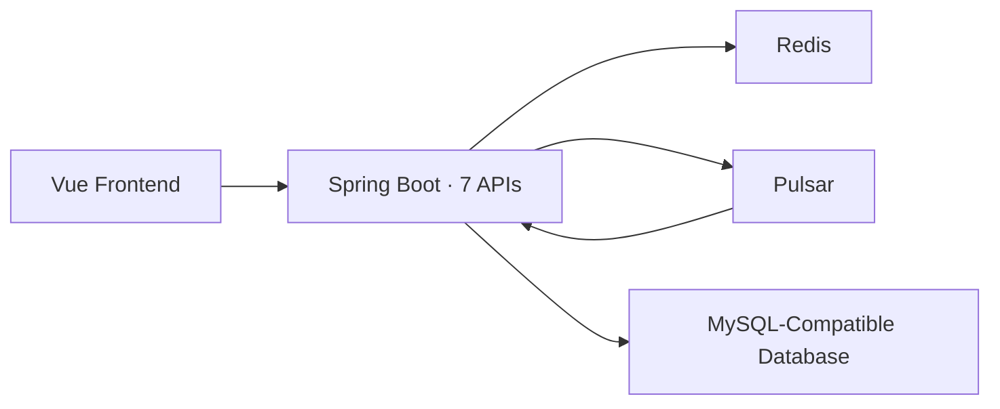

# yu-like Repository Study

[All studies](../../README.md) · [Backend Engineering](../README.md)

> **Table of Contents**
>
> - [0. Overview](#0-overview)
> - [1. Backend](#1-backend)
> - [2. Engineering Coverage](#2-engineering-coverage)

## 0. Overview

> A like system with Redis-first writes and Pulsar-based persistence.

> - Source: [liyupi/yu-like](https://github.com/liyupi/yu-like).
> - Revision: `main` at [`cb6e099`](https://github.com/liyupi/yu-like/commit/cb6e099fa65e4237fda3a76aafbe247d94e7dda3).
> - Depth: Low.
> - Status: Incomplete.

1. Frontend
   - `thumb-front`: Vue 3, Pinia 3, and Tailwind CSS 3.
2. [Backend](#1-backend): One application with 7 HTTP endpoints.
   - Default service uses Redis Lua and Pulsar batch persistence.
   - Alternative services demonstrate local caching and scheduled synchronization.
3. Technology stack
   - Application foundation

     <table>
       <tbody>
         <tr><td>Java 21 · Spring Boot 3.4.3</td><td>Virtual-thread example sits in an inactive synchronization job.</td></tr>
         <tr><td>MyBatis-Plus 3.5.10.1</td><td></td></tr>
         <tr><td>HeavyKeeper · Caffeine 3.1.8</td><td>Alternative service: Top 100 hot keys; 1,000-entry cache with 5-minute TTL.</td></tr>
       </tbody>
     </table>

   - Data and messaging

     <table>
       <tbody>
         <tr><td>MySQL JDBC · TiDB</td><td>Datasource is a placeholder; TiDB topology is only described in README.</td></tr>
         <tr><td>Redis · Jedis · Spring Session</td><td>Single-host configuration; Lua deduplicates likes.</td></tr>
         <tr><td>Spring Pulsar</td><td>Batch consumer, retry backoff, and dead-letter policy.</td></tr>
         <tr><td>Actuator · Prometheus</td><td>HTTP latency and like-result metrics.</td></tr>
       </tbody>
     </table>

4. Setup
   - Runtime: Java 21; Maven 3.9.9 wrapper.
   - Database: `sql/create_table.sql`.
   - Supply database, Redis, and Pulsar settings; the selected `local` profile is not included.
5. [Engineering Coverage](#2-engineering-coverage).

## 1. Backend

> One application with 7 HTTP endpoints.

| Component | API endpoints | Purpose |
| --- | ---: | --- |
| `thumb-backend` | 7 | Login, blog queries, likes, and greeting. |
| Total | 7 | One application; embedded Pulsar consumers and reconciliation job. |

## 2. Engineering Coverage

> ✅ Covered · 🟡 Limited · ❌ Not covered · ❓ Unknown.

<table>
  <thead>
    <tr><th>L1 area</th><th>L2 area</th><th>Status</th></tr>
  </thead>
  <tbody>
    <tr><td rowspan="9">Caching</td><td>Basic cache usage</td><td>✅</td></tr>
    <tr><td>Redis cluster</td><td>❌</td></tr>
    <tr><td>Redis Sentinel</td><td>❌</td></tr>
    <tr><td>Redis server tuning</td><td>❌</td></tr>
    <tr><td>Cache penetration protection</td><td>❌</td></tr>
    <tr><td>Cache breakdown protection</td><td>❌</td></tr>
    <tr><td>Cache avalanche protection</td><td>❌</td></tr>
    <tr><td>Cache pollution control</td><td>✅</td></tr>
    <tr><td>Database-cache consistency</td><td>🟡</td></tr>
    <tr><td rowspan="4">Database scaling</td><td>Database cluster</td><td>❓</td></tr>
    <tr><td>Replicas</td><td>❓</td></tr>
    <tr><td>Sharding</td><td>❓</td></tr>
    <tr><td>Read/write splitting</td><td>❌</td></tr>
    <tr><td rowspan="4">Distributed locking</td><td>Distributed lock</td><td>❌</td></tr>
    <tr><td>Ownership-safe release</td><td>❌</td></tr>
    <tr><td>Lease renewal</td><td>❌</td></tr>
    <tr><td>Redlock quorum</td><td>❌</td></tr>
    <tr><td rowspan="6">Concurrency</td><td>Application-managed threads</td><td>🟡</td></tr>
    <tr><td>Custom thread pool</td><td>❌</td></tr>
    <tr><td><code>CompletableFuture</code></td><td>🟡</td></tr>
    <tr><td>JVM synchronization and locks</td><td>✅</td></tr>
    <tr><td>Atomic classes or CAS</td><td>✅</td></tr>
    <tr><td>Thread-local state</td><td>❌</td></tr>
    <tr><td rowspan="3">Asynchronous processing</td><td>Application async executor</td><td>❌</td></tr>
    <tr><td>Scheduled background jobs</td><td>✅</td></tr>
    <tr><td>External asynchronous callbacks</td><td>❌</td></tr>
    <tr><td rowspan="5">Traffic handling</td><td>Spike-traffic strategy</td><td>✅</td></tr>
    <tr><td>Rate limiting</td><td>❌</td></tr>
    <tr><td>Circuit breaker</td><td>❌</td></tr>
    <tr><td>Load testing</td><td>🟡</td></tr>
    <tr><td>Stated capacity</td><td>❓</td></tr>
  </tbody>
</table>
