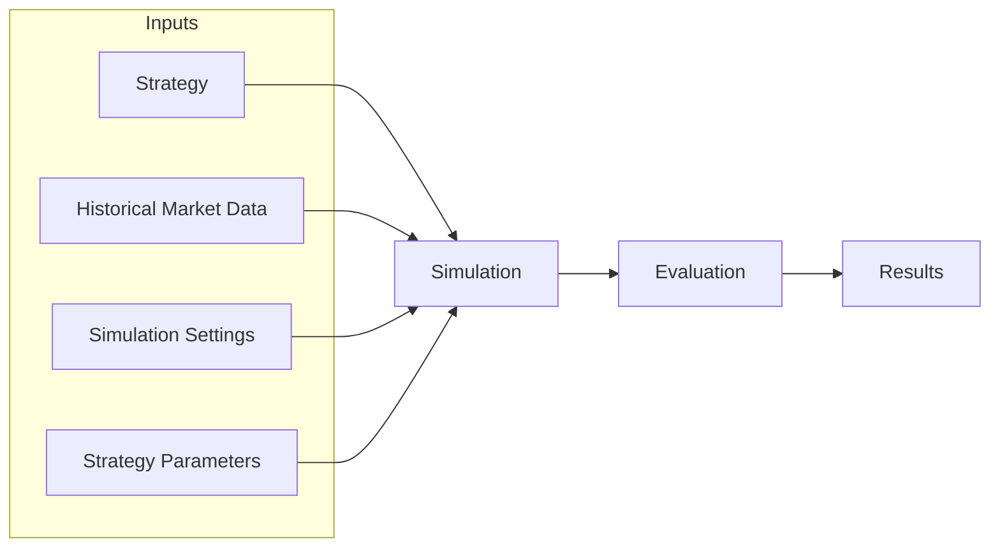
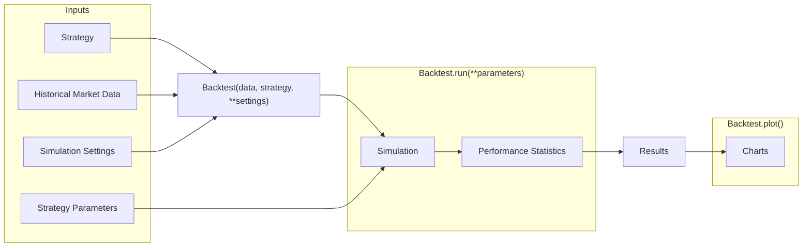

# Backtesting.py Repository Study

[All studies](../../README.md) · [Trading](../README.md)

> Table of Contents
>
> - [0. Overview](#0-overview)

## 0. Overview

> A Python backtesting framework for OHLCV data; included strategies are examples.

> - Source: [kernc/backtesting.py](https://github.com/kernc/backtesting.py).
> - Studied revision: `master` at [ca2e261](https://github.com/kernc/backtesting.py/commit/ca2e2611621e472542ba90f7243a1fa06a7d7108).
> - Inspected: `2026-10-05`.

**Workflow**



**Code**



1. Inputs
   - <code><a href="specs/01-data-contracts.md#11-backtest">Backtest</a>(...)</code>
     - Historical Market Data: A pandas <code><a href="specs/01-data-contracts.md#12-_data">DataFrame</a></code> of OHLCV candles; volume is optional.
     - [Strategy](specs/01-data-contracts.md#14-strategy): Your Python subclass.
     - Simulation Settings: 8 optional account and execution options.

     ```python
     bt = Backtest(
         data=data,                 # Required: Historical Market Data
         strategy=MyStrategy,       # Required: Strategy

         # Simulation Settings (optional; defaults shown)
         cash=10_000,
         spread=0.0,
         commission=0.0,
         margin=1.0,
         trade_on_close=False,
         hedging=False,
         exclusive_orders=False,
         finalize_trades=False,
     )
     ```

   - <code><a href="specs/01-data-contracts.md#11-backtest">Backtest</a>.run(...)</code>
     - Strategy Parameters: Optional values defined by your strategy class.

     ```python
     results = bt.run(threshold=100)  # If MyStrategy declares threshold
     ```

2. [Simulation](01-simulation.md): Replays historical candles and simulates [orders](specs/01-data-contracts.md#21-order), [trades](specs/01-data-contracts.md#22-trade), and account changes.
   - Entry point: <code><a href="specs/01-data-contracts.md#11-backtest">Backtest</a>.run()</code>.
3. Evaluation
   - Performance Statistics: Calculated during <code><a href="specs/01-data-contracts.md#11-backtest">Backtest</a>.run()</code> after the simulation.
   - Charts: Generated from the results by <code><a href="specs/01-data-contracts.md#11-backtest">Backtest</a>.plot()</code>.

> Specs: [Data Contracts](specs/01-data-contracts.md) · [Methods](specs/02-methods.md)
