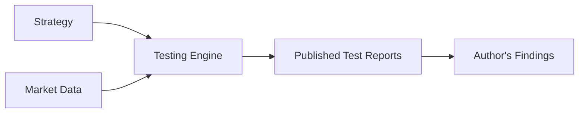

# Crypto-Strategies Repository Study

[All studies](../../README.md) · [Trading](../README.md)

> Table of Contents
>
> - [0. Overview](#0-overview)
> - [1. Strategy Catalog](#1-strategy-catalog)
>   - [1.1 Strategy Families](#11-strategy-families)
>   - [1.2 All Strategies](#12-all-strategies)
> - [2. Published Test Reports](#2-published-test-reports)
> - [3. Author's Findings](#3-authors-findings)

## 0. Overview

> 416 crypto strategies with Published Test Reports and Author's Findings.
>
> - Testing Engine and Market Data are external.
> - Focus: Study the Author's Findings.

> - Source: [CacheCarti/Crypto-Strategies](https://github.com/CacheCarti/Crypto-Strategies).
> - Studied revision: `main` at [f8e3259](https://github.com/CacheCarti/Crypto-Strategies/commit/f8e32599c192b823dbe7aea77a2b9341c6114527).
> - Inspected: `2026-10-05`.

1. [Strategy](#1-strategy-catalog): 416 strategies.
   - `strategies/`: 406 strategies.
   - `passed/`: 10 strategies.
2. Market Data
   - Claimed: approximately six months of Binance 5-minute candles.
   - Start/end dates: `❓ Unknown`.
3. Testing Engine
   - External; implementation unknown, so validation cannot be verified.
   - Claimed seven-stage validation:
     1. Static safety scan
     2. In-sample backtest
     3. Out-of-sample test
     4. Walk-forward
     5. Randomized starts
     6. Slippage stress
     7. Final holdout
4. [Published Test Reports](#2-published-test-reports)
   - `cards/`: 416 reports, one per strategy.
5. [Author's Findings](#3-authors-findings)
   - `FINDINGS.md`

## 1. Strategy Catalog

- 416 strategies across 53 families; strategies in one family are versions of the same idea.
- Passed and Rejected are the repository's published labels.

1. [Strategy Families](#11-strategy-families)
2. [All Strategies](#12-all-strategies)

### 1.1 Strategy Families

- The study grouping follows each family's main strategy idea; individual versions may differ.

| Type | Families | Strategies | Passed |
| --- | ---: | ---: | ---: |
| Trend and Breakout | 16 | 133 | 2 |
| Reversal and Mean Reversion | 17 | 135 | 2 |
| Sentiment and Funding | 11 | 82 | 0 |
| Session and Seasonality | 4 | 26 | 4 |
| Cross-Asset | 5 | 40 | 2 |
| Total | 53 | 416 | 10 |

<table>
  <thead>
    <tr><th>Type</th><th>Strategy Family</th><th>Family ID</th><th>Market</th><th>Strategies</th><th>Passed</th></tr>
  </thead>
  <tbody>
    <tr><td rowspan="16">Trend and Breakout</td><td>Momentum acceleration</td><td><code>accel_mom_sol</code></td><td>SOL/USDC</td><td align="right">7</td><td align="right">0</td></tr>
    <tr><td>Volatility expansion momentum</td><td><code>atr_exp_btc</code></td><td>BTC/USDC</td><td align="right">9</td><td align="right">0</td></tr>
    <tr><td>Bollinger squeeze breakout</td><td><code>bb_squeeze_sol</code></td><td>SOL/USDC</td><td align="right">9</td><td align="right">0</td></tr>
    <tr><td>Order book imbalance momentum</td><td><code>book_imb_mom_btc</code></td><td>BTC/USDC</td><td align="right">9</td><td align="right">0</td></tr>
    <tr><td>Calm regime trend</td><td><code>calm_grind_btc</code></td><td>BTC/USDC</td><td align="right">8</td><td align="right">0</td></tr>
    <tr><td>Donchian breakout</td><td><code>donchian_vol_btc</code></td><td>BTC/USDC</td><td align="right">9</td><td align="right">0</td></tr>
    <tr><td>EMA trend pullback</td><td><code>ema_pullback_eth</code></td><td>ETH/USDC</td><td align="right">7</td><td align="right">1</td></tr>
    <tr><td>Higher low uptrend</td><td><code>higher_low_eth</code></td><td>ETH/USDC</td><td align="right">9</td><td align="right">0</td></tr>
    <tr><td>Low volatility momentum</td><td><code>lowvol_mom_btc</code></td><td>BTC/USDC</td><td align="right">8</td><td align="right">0</td></tr>
    <tr><td>EMA ribbon trend</td><td><code>ribbon_trend_sol</code></td><td>SOL/USDC</td><td align="right">8</td><td align="right">0</td></tr>
    <tr><td>EMA momentum scalp</td><td><code>scalp_ema513_eth</code></td><td>ETH/USDC</td><td align="right">7</td><td align="right">0</td></tr>
    <tr><td>Trend pullback scalp</td><td><code>scalp_mom_pull_eth</code></td><td>ETH/USDC</td><td align="right">8</td><td align="right">0</td></tr>
    <tr><td>Volume burst scalp</td><td><code>scalp_volburst_btc</code></td><td>BTC/USDC</td><td align="right">9</td><td align="right">0</td></tr>
    <tr><td>Volume burst momentum</td><td><code>vol_burst_sol</code></td><td>SOL/USDC</td><td align="right">8</td><td align="right">1</td></tr>
    <tr><td>Post-spike coil breakout</td><td><code>vol_collapse_eth</code></td><td>ETH/USDC</td><td align="right">9</td><td align="right">0</td></tr>
    <tr><td>Volatility-gated momentum</td><td><code>vol_gate_mom_eth</code></td><td>ETH/USDC</td><td align="right">9</td><td align="right">0</td></tr>
    <tr><td rowspan="17">Reversal and Mean Reversion</td><td>BTC crash recovery</td><td><code>crash_recovery_btc</code></td><td>BTC/USDC</td><td align="right">6</td><td align="right">0</td></tr>
    <tr><td>ETH crash recovery</td><td><code>crash_recovery_eth</code></td><td>ETH/USDC</td><td align="right">7</td><td align="right">1</td></tr>
    <tr><td>SOL crash recovery</td><td><code>crash_recovery_sol</code></td><td>SOL/USDC</td><td align="right">6</td><td align="right">0</td></tr>
    <tr><td>Failed breakout fade</td><td><code>donchian_fade_eth</code></td><td>ETH/USDC</td><td align="right">8</td><td align="right">0</td></tr>
    <tr><td>Wick fill reversion</td><td><code>gap_fade_btc</code></td><td>BTC/USDC</td><td align="right">9</td><td align="right">1</td></tr>
    <tr><td>Liquidation cascade exhaustion</td><td><code>liq_cascade_sol</code></td><td>SOL/USDC</td><td align="right">8</td><td align="right">0</td></tr>
    <tr><td>Bollinger percent B reversion</td><td><code>pctb_fade_sol</code></td><td>SOL/USDC</td><td align="right">7</td><td align="right">0</td></tr>
    <tr><td>RSI(2) snapback</td><td><code>rsi2_revert_eth</code></td><td>ETH/USDC</td><td align="right">9</td><td align="right">0</td></tr>
    <tr><td>RSI divergence</td><td><code>rsi_div_eth</code></td><td>ETH/USDC</td><td align="right">4</td><td align="right">0</td></tr>
    <tr><td>RSI mean reversion</td><td><code>rsi_revert_sol</code></td><td>SOL/USDC</td><td align="right">8</td><td align="right">0</td></tr>
    <tr><td>Range fade scalp</td><td><code>scalp_range_sol</code></td><td>SOL/USDC</td><td align="right">9</td><td align="right">0</td></tr>
    <tr><td>Fast RSI snapback scalp</td><td><code>scalp_rsi7_btc</code></td><td>BTC/USDC</td><td align="right">9</td><td align="right">0</td></tr>
    <tr><td>Stochastic reversion scalp</td><td><code>scalp_stoch_eth</code></td><td>ETH/USDC</td><td align="right">9</td><td align="right">0</td></tr>
    <tr><td>VWAP reversion scalp</td><td><code>scalp_vwap_sol</code></td><td>SOL/USDC</td><td align="right">9</td><td align="right">0</td></tr>
    <tr><td>Streak reversal exhaustion</td><td><code>streak_revert_btc</code></td><td>BTC/USDC</td><td align="right">9</td><td align="right">0</td></tr>
    <tr><td>Triple support bounce</td><td><code>triple_touch_eth</code></td><td>ETH/USDC</td><td align="right">9</td><td align="right">0</td></tr>
    <tr><td>Z-score reversion</td><td><code>zscore_fade_btc</code></td><td>BTC/USDC</td><td align="right">9</td><td align="right">0</td></tr>
    <tr><td rowspan="11">Sentiment and Funding</td><td>Multi-signal confluence</td><td><code>confluence_long_eth</code></td><td>ETH/USDC</td><td align="right">9</td><td align="right">0</td></tr>
    <tr><td>Fear and greed contrarian</td><td><code>fng_contrarian_btc</code></td><td>BTC/USDC</td><td align="right">6</td><td align="right">0</td></tr>
    <tr><td>Fear-regime accumulation</td><td><code>fng_dca_btc</code></td><td>BTC/USDC</td><td align="right">9</td><td align="right">0</td></tr>
    <tr><td>Sentiment momentum</td><td><code>fng_mom_btc</code></td><td>BTC/USDC</td><td align="right">6</td><td align="right">0</td></tr>
    <tr><td>Sentiment pullback reversion</td><td><code>fng_pullback_sol</code></td><td>SOL/USDC</td><td align="right">4</td><td align="right">0</td></tr>
    <tr><td>Sentiment capitulation streak</td><td><code>fng_streak_sol</code></td><td>SOL/USDC</td><td align="right">9</td><td align="right">0</td></tr>
    <tr><td>Funding carry swing</td><td><code>funding_carry_btc</code></td><td>BTC/USDC</td><td align="right">8</td><td align="right">0</td></tr>
    <tr><td>Funding contrarian fade</td><td><code>funding_fade_eth</code></td><td>ETH/USDC</td><td align="right">6</td><td align="right">0</td></tr>
    <tr><td>Funding rate unwind</td><td><code>funding_flip_eth</code></td><td>ETH/USDC</td><td align="right">8</td><td align="right">0</td></tr>
    <tr><td>Funding squeeze divergence</td><td><code>funding_squeeze_btc</code></td><td>BTC/USDC</td><td align="right">8</td><td align="right">0</td></tr>
    <tr><td>Funding-tilted RSI scalp</td><td><code>scalp_funding_eth</code></td><td>ETH/USDC</td><td align="right">9</td><td align="right">0</td></tr>
    <tr><td rowspan="4">Session and Seasonality</td><td>Asia session drift continuation</td><td><code>asia_drift_btc</code></td><td>BTC/USDC</td><td align="right">5</td><td align="right">3</td></tr>
    <tr><td>Weekday seasonality</td><td><code>monday_drift_sol</code></td><td>SOL/USDC</td><td align="right">8</td><td align="right">1</td></tr>
    <tr><td>US session momentum</td><td><code>us_session_mom_btc</code></td><td>BTC/USDC</td><td align="right">6</td><td align="right">0</td></tr>
    <tr><td>Weekend drift seasonality</td><td><code>weekend_season_eth</code></td><td>ETH/USDC</td><td align="right">7</td><td align="right">0</td></tr>
    <tr><td rowspan="5">Cross-Asset</td><td>BTC-led SOL momentum</td><td><code>btc_lead_sol</code></td><td>SOL/USDC</td><td align="right">9</td><td align="right">0</td></tr>
    <tr><td>ETH-BTC spread catch-up</td><td><code>cross_regime_eth</code></td><td>ETH/USDC</td><td align="right">9</td><td align="right">0</td></tr>
    <tr><td>ETH-BTC relative strength</td><td><code>rel_strength_eth</code></td><td>ETH/USDC</td><td align="right">5</td><td align="right">1</td></tr>
    <tr><td>BTC-led SOL catch-up scalp</td><td><code>scalp_btclead_sol</code></td><td>SOL/USDC</td><td align="right">8</td><td align="right">1</td></tr>
    <tr><td>ETH-led SOL momentum</td><td><code>sol_eth_lead_sol</code></td><td>SOL/USDC</td><td align="right">9</td><td align="right">0</td></tr>
  </tbody>
</table>

### 1.2 All Strategies

- Strategies are grouped by family, with passed strategies first within each family. Paths are relative to the upstream repository root.

<table>
  <thead>
    <tr><th>Strategy Family</th><th>Published Status</th><th>Path</th></tr>
  </thead>
  <tbody>
    <tr><td rowspan="5">Asia session drift continuation</td><td>Passed</td><td><code>passed/asia_drift_btc_v2.py</code></td></tr>
    <tr><td>Passed</td><td><code>passed/asia_drift_btc_v3.py</code></td></tr>
    <tr><td>Passed</td><td><code>passed/asia_drift_btc_v9.py</code></td></tr>
    <tr><td>Rejected</td><td><code>strategies/asia_drift_btc.py</code></td></tr>
    <tr><td>Rejected</td><td><code>strategies/asia_drift_btc_v8.py</code></td></tr>
    <tr><td rowspan="7">ETH crash recovery</td><td>Passed</td><td><code>passed/crash_recovery_eth_v3.py</code></td></tr>
    <tr><td>Rejected</td><td><code>strategies/crash_recovery_eth.py</code></td></tr>
    <tr><td>Rejected</td><td><code>strategies/crash_recovery_eth_v2.py</code></td></tr>
    <tr><td>Rejected</td><td><code>strategies/crash_recovery_eth_v4.py</code></td></tr>
    <tr><td>Rejected</td><td><code>strategies/crash_recovery_eth_v5.py</code></td></tr>
    <tr><td>Rejected</td><td><code>strategies/crash_recovery_eth_v7.py</code></td></tr>
    <tr><td>Rejected</td><td><code>strategies/crash_recovery_eth_v8.py</code></td></tr>
    <tr><td rowspan="7">EMA trend pullback</td><td>Passed</td><td><code>passed/ema_pullback_eth_v7.py</code></td></tr>
    <tr><td>Rejected</td><td><code>strategies/ema_pullback_eth.py</code></td></tr>
    <tr><td>Rejected</td><td><code>strategies/ema_pullback_eth_v2.py</code></td></tr>
    <tr><td>Rejected</td><td><code>strategies/ema_pullback_eth_v3.py</code></td></tr>
    <tr><td>Rejected</td><td><code>strategies/ema_pullback_eth_v4.py</code></td></tr>
    <tr><td>Rejected</td><td><code>strategies/ema_pullback_eth_v8.py</code></td></tr>
    <tr><td>Rejected</td><td><code>strategies/ema_pullback_eth_v9.py</code></td></tr>
    <tr><td rowspan="9">Wick fill reversion</td><td>Passed</td><td><code>passed/gap_fade_btc_v8.py</code></td></tr>
    <tr><td>Rejected</td><td><code>strategies/gap_fade_btc.py</code></td></tr>
    <tr><td>Rejected</td><td><code>strategies/gap_fade_btc_v2.py</code></td></tr>
    <tr><td>Rejected</td><td><code>strategies/gap_fade_btc_v3.py</code></td></tr>
    <tr><td>Rejected</td><td><code>strategies/gap_fade_btc_v4.py</code></td></tr>
    <tr><td>Rejected</td><td><code>strategies/gap_fade_btc_v5.py</code></td></tr>
    <tr><td>Rejected</td><td><code>strategies/gap_fade_btc_v6.py</code></td></tr>
    <tr><td>Rejected</td><td><code>strategies/gap_fade_btc_v7.py</code></td></tr>
    <tr><td>Rejected</td><td><code>strategies/gap_fade_btc_v9.py</code></td></tr>
    <tr><td rowspan="8">Weekday seasonality</td><td>Passed</td><td><code>passed/monday_drift_sol_v4.py</code></td></tr>
    <tr><td>Rejected</td><td><code>strategies/monday_drift_sol.py</code></td></tr>
    <tr><td>Rejected</td><td><code>strategies/monday_drift_sol_v2.py</code></td></tr>
    <tr><td>Rejected</td><td><code>strategies/monday_drift_sol_v3.py</code></td></tr>
    <tr><td>Rejected</td><td><code>strategies/monday_drift_sol_v5.py</code></td></tr>
    <tr><td>Rejected</td><td><code>strategies/monday_drift_sol_v6.py</code></td></tr>
    <tr><td>Rejected</td><td><code>strategies/monday_drift_sol_v7.py</code></td></tr>
    <tr><td>Rejected</td><td><code>strategies/monday_drift_sol_v9.py</code></td></tr>
    <tr><td rowspan="5">ETH-BTC relative strength</td><td>Passed</td><td><code>passed/rel_strength_eth_v3.py</code></td></tr>
    <tr><td>Rejected</td><td><code>strategies/rel_strength_eth_v5.py</code></td></tr>
    <tr><td>Rejected</td><td><code>strategies/rel_strength_eth_v6.py</code></td></tr>
    <tr><td>Rejected</td><td><code>strategies/rel_strength_eth_v8.py</code></td></tr>
    <tr><td>Rejected</td><td><code>strategies/rel_strength_eth_v9.py</code></td></tr>
    <tr><td rowspan="8">BTC-led SOL catch-up scalp</td><td>Passed</td><td><code>passed/scalp_btclead_sol_v3.py</code></td></tr>
    <tr><td>Rejected</td><td><code>strategies/scalp_btclead_sol.py</code></td></tr>
    <tr><td>Rejected</td><td><code>strategies/scalp_btclead_sol_v2.py</code></td></tr>
    <tr><td>Rejected</td><td><code>strategies/scalp_btclead_sol_v5.py</code></td></tr>
    <tr><td>Rejected</td><td><code>strategies/scalp_btclead_sol_v6.py</code></td></tr>
    <tr><td>Rejected</td><td><code>strategies/scalp_btclead_sol_v7.py</code></td></tr>
    <tr><td>Rejected</td><td><code>strategies/scalp_btclead_sol_v8.py</code></td></tr>
    <tr><td>Rejected</td><td><code>strategies/scalp_btclead_sol_v9.py</code></td></tr>
    <tr><td rowspan="8">Volume burst momentum</td><td>Passed</td><td><code>passed/vol_burst_sol_v2.py</code></td></tr>
    <tr><td>Rejected</td><td><code>strategies/vol_burst_sol_v3.py</code></td></tr>
    <tr><td>Rejected</td><td><code>strategies/vol_burst_sol_v4.py</code></td></tr>
    <tr><td>Rejected</td><td><code>strategies/vol_burst_sol_v5.py</code></td></tr>
    <tr><td>Rejected</td><td><code>strategies/vol_burst_sol_v6.py</code></td></tr>
    <tr><td>Rejected</td><td><code>strategies/vol_burst_sol_v7.py</code></td></tr>
    <tr><td>Rejected</td><td><code>strategies/vol_burst_sol_v8.py</code></td></tr>
    <tr><td>Rejected</td><td><code>strategies/vol_burst_sol_v9.py</code></td></tr>
    <tr><td rowspan="7">Momentum acceleration</td><td>Rejected</td><td><code>strategies/accel_mom_sol.py</code></td></tr>
    <tr><td>Rejected</td><td><code>strategies/accel_mom_sol_v2.py</code></td></tr>
    <tr><td>Rejected</td><td><code>strategies/accel_mom_sol_v5.py</code></td></tr>
    <tr><td>Rejected</td><td><code>strategies/accel_mom_sol_v6.py</code></td></tr>
    <tr><td>Rejected</td><td><code>strategies/accel_mom_sol_v7.py</code></td></tr>
    <tr><td>Rejected</td><td><code>strategies/accel_mom_sol_v8.py</code></td></tr>
    <tr><td>Rejected</td><td><code>strategies/accel_mom_sol_v9.py</code></td></tr>
    <tr><td rowspan="9">Volatility expansion momentum</td><td>Rejected</td><td><code>strategies/atr_exp_btc.py</code></td></tr>
    <tr><td>Rejected</td><td><code>strategies/atr_exp_btc_v2.py</code></td></tr>
    <tr><td>Rejected</td><td><code>strategies/atr_exp_btc_v3.py</code></td></tr>
    <tr><td>Rejected</td><td><code>strategies/atr_exp_btc_v4.py</code></td></tr>
    <tr><td>Rejected</td><td><code>strategies/atr_exp_btc_v5.py</code></td></tr>
    <tr><td>Rejected</td><td><code>strategies/atr_exp_btc_v6.py</code></td></tr>
    <tr><td>Rejected</td><td><code>strategies/atr_exp_btc_v7.py</code></td></tr>
    <tr><td>Rejected</td><td><code>strategies/atr_exp_btc_v8.py</code></td></tr>
    <tr><td>Rejected</td><td><code>strategies/atr_exp_btc_v9.py</code></td></tr>
    <tr><td rowspan="9">Bollinger squeeze breakout</td><td>Rejected</td><td><code>strategies/bb_squeeze_sol.py</code></td></tr>
    <tr><td>Rejected</td><td><code>strategies/bb_squeeze_sol_v2.py</code></td></tr>
    <tr><td>Rejected</td><td><code>strategies/bb_squeeze_sol_v3.py</code></td></tr>
    <tr><td>Rejected</td><td><code>strategies/bb_squeeze_sol_v4.py</code></td></tr>
    <tr><td>Rejected</td><td><code>strategies/bb_squeeze_sol_v5.py</code></td></tr>
    <tr><td>Rejected</td><td><code>strategies/bb_squeeze_sol_v6.py</code></td></tr>
    <tr><td>Rejected</td><td><code>strategies/bb_squeeze_sol_v7.py</code></td></tr>
    <tr><td>Rejected</td><td><code>strategies/bb_squeeze_sol_v8.py</code></td></tr>
    <tr><td>Rejected</td><td><code>strategies/bb_squeeze_sol_v9.py</code></td></tr>
    <tr><td rowspan="9">Order book imbalance momentum</td><td>Rejected</td><td><code>strategies/book_imb_mom_btc.py</code></td></tr>
    <tr><td>Rejected</td><td><code>strategies/book_imb_mom_btc_v2.py</code></td></tr>
    <tr><td>Rejected</td><td><code>strategies/book_imb_mom_btc_v3.py</code></td></tr>
    <tr><td>Rejected</td><td><code>strategies/book_imb_mom_btc_v4.py</code></td></tr>
    <tr><td>Rejected</td><td><code>strategies/book_imb_mom_btc_v5.py</code></td></tr>
    <tr><td>Rejected</td><td><code>strategies/book_imb_mom_btc_v6.py</code></td></tr>
    <tr><td>Rejected</td><td><code>strategies/book_imb_mom_btc_v7.py</code></td></tr>
    <tr><td>Rejected</td><td><code>strategies/book_imb_mom_btc_v8.py</code></td></tr>
    <tr><td>Rejected</td><td><code>strategies/book_imb_mom_btc_v9.py</code></td></tr>
    <tr><td rowspan="9">BTC-led SOL momentum</td><td>Rejected</td><td><code>strategies/btc_lead_sol.py</code></td></tr>
    <tr><td>Rejected</td><td><code>strategies/btc_lead_sol_v2.py</code></td></tr>
    <tr><td>Rejected</td><td><code>strategies/btc_lead_sol_v3.py</code></td></tr>
    <tr><td>Rejected</td><td><code>strategies/btc_lead_sol_v4.py</code></td></tr>
    <tr><td>Rejected</td><td><code>strategies/btc_lead_sol_v5.py</code></td></tr>
    <tr><td>Rejected</td><td><code>strategies/btc_lead_sol_v6.py</code></td></tr>
    <tr><td>Rejected</td><td><code>strategies/btc_lead_sol_v7.py</code></td></tr>
    <tr><td>Rejected</td><td><code>strategies/btc_lead_sol_v8.py</code></td></tr>
    <tr><td>Rejected</td><td><code>strategies/btc_lead_sol_v9.py</code></td></tr>
    <tr><td rowspan="8">Calm regime trend</td><td>Rejected</td><td><code>strategies/calm_grind_btc.py</code></td></tr>
    <tr><td>Rejected</td><td><code>strategies/calm_grind_btc_v2.py</code></td></tr>
    <tr><td>Rejected</td><td><code>strategies/calm_grind_btc_v3.py</code></td></tr>
    <tr><td>Rejected</td><td><code>strategies/calm_grind_btc_v4.py</code></td></tr>
    <tr><td>Rejected</td><td><code>strategies/calm_grind_btc_v6.py</code></td></tr>
    <tr><td>Rejected</td><td><code>strategies/calm_grind_btc_v7.py</code></td></tr>
    <tr><td>Rejected</td><td><code>strategies/calm_grind_btc_v8.py</code></td></tr>
    <tr><td>Rejected</td><td><code>strategies/calm_grind_btc_v9.py</code></td></tr>
    <tr><td rowspan="9">Multi-signal confluence</td><td>Rejected</td><td><code>strategies/confluence_long_eth.py</code></td></tr>
    <tr><td>Rejected</td><td><code>strategies/confluence_long_eth_v2.py</code></td></tr>
    <tr><td>Rejected</td><td><code>strategies/confluence_long_eth_v3.py</code></td></tr>
    <tr><td>Rejected</td><td><code>strategies/confluence_long_eth_v4.py</code></td></tr>
    <tr><td>Rejected</td><td><code>strategies/confluence_long_eth_v5.py</code></td></tr>
    <tr><td>Rejected</td><td><code>strategies/confluence_long_eth_v6.py</code></td></tr>
    <tr><td>Rejected</td><td><code>strategies/confluence_long_eth_v7.py</code></td></tr>
    <tr><td>Rejected</td><td><code>strategies/confluence_long_eth_v8.py</code></td></tr>
    <tr><td>Rejected</td><td><code>strategies/confluence_long_eth_v9.py</code></td></tr>
    <tr><td rowspan="6">BTC crash recovery</td><td>Rejected</td><td><code>strategies/crash_recovery_btc.py</code></td></tr>
    <tr><td>Rejected</td><td><code>strategies/crash_recovery_btc_v2.py</code></td></tr>
    <tr><td>Rejected</td><td><code>strategies/crash_recovery_btc_v5.py</code></td></tr>
    <tr><td>Rejected</td><td><code>strategies/crash_recovery_btc_v7.py</code></td></tr>
    <tr><td>Rejected</td><td><code>strategies/crash_recovery_btc_v8.py</code></td></tr>
    <tr><td>Rejected</td><td><code>strategies/crash_recovery_btc_v9.py</code></td></tr>
    <tr><td rowspan="6">SOL crash recovery</td><td>Rejected</td><td><code>strategies/crash_recovery_sol_v2.py</code></td></tr>
    <tr><td>Rejected</td><td><code>strategies/crash_recovery_sol_v4.py</code></td></tr>
    <tr><td>Rejected</td><td><code>strategies/crash_recovery_sol_v5.py</code></td></tr>
    <tr><td>Rejected</td><td><code>strategies/crash_recovery_sol_v6.py</code></td></tr>
    <tr><td>Rejected</td><td><code>strategies/crash_recovery_sol_v7.py</code></td></tr>
    <tr><td>Rejected</td><td><code>strategies/crash_recovery_sol_v9.py</code></td></tr>
    <tr><td rowspan="9">ETH-BTC spread catch-up</td><td>Rejected</td><td><code>strategies/cross_regime_eth.py</code></td></tr>
    <tr><td>Rejected</td><td><code>strategies/cross_regime_eth_v2.py</code></td></tr>
    <tr><td>Rejected</td><td><code>strategies/cross_regime_eth_v3.py</code></td></tr>
    <tr><td>Rejected</td><td><code>strategies/cross_regime_eth_v4.py</code></td></tr>
    <tr><td>Rejected</td><td><code>strategies/cross_regime_eth_v5.py</code></td></tr>
    <tr><td>Rejected</td><td><code>strategies/cross_regime_eth_v6.py</code></td></tr>
    <tr><td>Rejected</td><td><code>strategies/cross_regime_eth_v7.py</code></td></tr>
    <tr><td>Rejected</td><td><code>strategies/cross_regime_eth_v8.py</code></td></tr>
    <tr><td>Rejected</td><td><code>strategies/cross_regime_eth_v9.py</code></td></tr>
    <tr><td rowspan="8">Failed breakout fade</td><td>Rejected</td><td><code>strategies/donchian_fade_eth.py</code></td></tr>
    <tr><td>Rejected</td><td><code>strategies/donchian_fade_eth_v2.py</code></td></tr>
    <tr><td>Rejected</td><td><code>strategies/donchian_fade_eth_v3.py</code></td></tr>
    <tr><td>Rejected</td><td><code>strategies/donchian_fade_eth_v4.py</code></td></tr>
    <tr><td>Rejected</td><td><code>strategies/donchian_fade_eth_v6.py</code></td></tr>
    <tr><td>Rejected</td><td><code>strategies/donchian_fade_eth_v7.py</code></td></tr>
    <tr><td>Rejected</td><td><code>strategies/donchian_fade_eth_v8.py</code></td></tr>
    <tr><td>Rejected</td><td><code>strategies/donchian_fade_eth_v9.py</code></td></tr>
    <tr><td rowspan="9">Donchian breakout</td><td>Rejected</td><td><code>strategies/donchian_vol_btc.py</code></td></tr>
    <tr><td>Rejected</td><td><code>strategies/donchian_vol_btc_v2.py</code></td></tr>
    <tr><td>Rejected</td><td><code>strategies/donchian_vol_btc_v3.py</code></td></tr>
    <tr><td>Rejected</td><td><code>strategies/donchian_vol_btc_v4.py</code></td></tr>
    <tr><td>Rejected</td><td><code>strategies/donchian_vol_btc_v5.py</code></td></tr>
    <tr><td>Rejected</td><td><code>strategies/donchian_vol_btc_v6.py</code></td></tr>
    <tr><td>Rejected</td><td><code>strategies/donchian_vol_btc_v7.py</code></td></tr>
    <tr><td>Rejected</td><td><code>strategies/donchian_vol_btc_v8.py</code></td></tr>
    <tr><td>Rejected</td><td><code>strategies/donchian_vol_btc_v9.py</code></td></tr>
    <tr><td rowspan="6">Fear and greed contrarian</td><td>Rejected</td><td><code>strategies/fng_contrarian_btc_v2.py</code></td></tr>
    <tr><td>Rejected</td><td><code>strategies/fng_contrarian_btc_v4.py</code></td></tr>
    <tr><td>Rejected</td><td><code>strategies/fng_contrarian_btc_v5.py</code></td></tr>
    <tr><td>Rejected</td><td><code>strategies/fng_contrarian_btc_v6.py</code></td></tr>
    <tr><td>Rejected</td><td><code>strategies/fng_contrarian_btc_v7.py</code></td></tr>
    <tr><td>Rejected</td><td><code>strategies/fng_contrarian_btc_v8.py</code></td></tr>
    <tr><td rowspan="9">Fear-regime accumulation</td><td>Rejected</td><td><code>strategies/fng_dca_btc.py</code></td></tr>
    <tr><td>Rejected</td><td><code>strategies/fng_dca_btc_v2.py</code></td></tr>
    <tr><td>Rejected</td><td><code>strategies/fng_dca_btc_v3.py</code></td></tr>
    <tr><td>Rejected</td><td><code>strategies/fng_dca_btc_v4.py</code></td></tr>
    <tr><td>Rejected</td><td><code>strategies/fng_dca_btc_v5.py</code></td></tr>
    <tr><td>Rejected</td><td><code>strategies/fng_dca_btc_v6.py</code></td></tr>
    <tr><td>Rejected</td><td><code>strategies/fng_dca_btc_v7.py</code></td></tr>
    <tr><td>Rejected</td><td><code>strategies/fng_dca_btc_v8.py</code></td></tr>
    <tr><td>Rejected</td><td><code>strategies/fng_dca_btc_v9.py</code></td></tr>
    <tr><td rowspan="6">Sentiment momentum</td><td>Rejected</td><td><code>strategies/fng_mom_btc.py</code></td></tr>
    <tr><td>Rejected</td><td><code>strategies/fng_mom_btc_v4.py</code></td></tr>
    <tr><td>Rejected</td><td><code>strategies/fng_mom_btc_v6.py</code></td></tr>
    <tr><td>Rejected</td><td><code>strategies/fng_mom_btc_v7.py</code></td></tr>
    <tr><td>Rejected</td><td><code>strategies/fng_mom_btc_v8.py</code></td></tr>
    <tr><td>Rejected</td><td><code>strategies/fng_mom_btc_v9.py</code></td></tr>
    <tr><td rowspan="4">Sentiment pullback reversion</td><td>Rejected</td><td><code>strategies/fng_pullback_sol_v3.py</code></td></tr>
    <tr><td>Rejected</td><td><code>strategies/fng_pullback_sol_v4.py</code></td></tr>
    <tr><td>Rejected</td><td><code>strategies/fng_pullback_sol_v7.py</code></td></tr>
    <tr><td>Rejected</td><td><code>strategies/fng_pullback_sol_v8.py</code></td></tr>
    <tr><td rowspan="9">Sentiment capitulation streak</td><td>Rejected</td><td><code>strategies/fng_streak_sol.py</code></td></tr>
    <tr><td>Rejected</td><td><code>strategies/fng_streak_sol_v2.py</code></td></tr>
    <tr><td>Rejected</td><td><code>strategies/fng_streak_sol_v3.py</code></td></tr>
    <tr><td>Rejected</td><td><code>strategies/fng_streak_sol_v4.py</code></td></tr>
    <tr><td>Rejected</td><td><code>strategies/fng_streak_sol_v5.py</code></td></tr>
    <tr><td>Rejected</td><td><code>strategies/fng_streak_sol_v6.py</code></td></tr>
    <tr><td>Rejected</td><td><code>strategies/fng_streak_sol_v7.py</code></td></tr>
    <tr><td>Rejected</td><td><code>strategies/fng_streak_sol_v8.py</code></td></tr>
    <tr><td>Rejected</td><td><code>strategies/fng_streak_sol_v9.py</code></td></tr>
    <tr><td rowspan="8">Funding carry swing</td><td>Rejected</td><td><code>strategies/funding_carry_btc.py</code></td></tr>
    <tr><td>Rejected</td><td><code>strategies/funding_carry_btc_v2.py</code></td></tr>
    <tr><td>Rejected</td><td><code>strategies/funding_carry_btc_v4.py</code></td></tr>
    <tr><td>Rejected</td><td><code>strategies/funding_carry_btc_v5.py</code></td></tr>
    <tr><td>Rejected</td><td><code>strategies/funding_carry_btc_v6.py</code></td></tr>
    <tr><td>Rejected</td><td><code>strategies/funding_carry_btc_v7.py</code></td></tr>
    <tr><td>Rejected</td><td><code>strategies/funding_carry_btc_v8.py</code></td></tr>
    <tr><td>Rejected</td><td><code>strategies/funding_carry_btc_v9.py</code></td></tr>
    <tr><td rowspan="6">Funding contrarian fade</td><td>Rejected</td><td><code>strategies/funding_fade_eth.py</code></td></tr>
    <tr><td>Rejected</td><td><code>strategies/funding_fade_eth_v2.py</code></td></tr>
    <tr><td>Rejected</td><td><code>strategies/funding_fade_eth_v4.py</code></td></tr>
    <tr><td>Rejected</td><td><code>strategies/funding_fade_eth_v6.py</code></td></tr>
    <tr><td>Rejected</td><td><code>strategies/funding_fade_eth_v7.py</code></td></tr>
    <tr><td>Rejected</td><td><code>strategies/funding_fade_eth_v9.py</code></td></tr>
    <tr><td rowspan="8">Funding rate unwind</td><td>Rejected</td><td><code>strategies/funding_flip_eth.py</code></td></tr>
    <tr><td>Rejected</td><td><code>strategies/funding_flip_eth_v3.py</code></td></tr>
    <tr><td>Rejected</td><td><code>strategies/funding_flip_eth_v4.py</code></td></tr>
    <tr><td>Rejected</td><td><code>strategies/funding_flip_eth_v5.py</code></td></tr>
    <tr><td>Rejected</td><td><code>strategies/funding_flip_eth_v6.py</code></td></tr>
    <tr><td>Rejected</td><td><code>strategies/funding_flip_eth_v7.py</code></td></tr>
    <tr><td>Rejected</td><td><code>strategies/funding_flip_eth_v8.py</code></td></tr>
    <tr><td>Rejected</td><td><code>strategies/funding_flip_eth_v9.py</code></td></tr>
    <tr><td rowspan="8">Funding squeeze divergence</td><td>Rejected</td><td><code>strategies/funding_squeeze_btc.py</code></td></tr>
    <tr><td>Rejected</td><td><code>strategies/funding_squeeze_btc_v2.py</code></td></tr>
    <tr><td>Rejected</td><td><code>strategies/funding_squeeze_btc_v3.py</code></td></tr>
    <tr><td>Rejected</td><td><code>strategies/funding_squeeze_btc_v4.py</code></td></tr>
    <tr><td>Rejected</td><td><code>strategies/funding_squeeze_btc_v6.py</code></td></tr>
    <tr><td>Rejected</td><td><code>strategies/funding_squeeze_btc_v7.py</code></td></tr>
    <tr><td>Rejected</td><td><code>strategies/funding_squeeze_btc_v8.py</code></td></tr>
    <tr><td>Rejected</td><td><code>strategies/funding_squeeze_btc_v9.py</code></td></tr>
    <tr><td rowspan="9">Higher low uptrend</td><td>Rejected</td><td><code>strategies/higher_low_eth.py</code></td></tr>
    <tr><td>Rejected</td><td><code>strategies/higher_low_eth_v2.py</code></td></tr>
    <tr><td>Rejected</td><td><code>strategies/higher_low_eth_v3.py</code></td></tr>
    <tr><td>Rejected</td><td><code>strategies/higher_low_eth_v4.py</code></td></tr>
    <tr><td>Rejected</td><td><code>strategies/higher_low_eth_v5.py</code></td></tr>
    <tr><td>Rejected</td><td><code>strategies/higher_low_eth_v6.py</code></td></tr>
    <tr><td>Rejected</td><td><code>strategies/higher_low_eth_v7.py</code></td></tr>
    <tr><td>Rejected</td><td><code>strategies/higher_low_eth_v8.py</code></td></tr>
    <tr><td>Rejected</td><td><code>strategies/higher_low_eth_v9.py</code></td></tr>
    <tr><td rowspan="8">Liquidation cascade exhaustion</td><td>Rejected</td><td><code>strategies/liq_cascade_sol.py</code></td></tr>
    <tr><td>Rejected</td><td><code>strategies/liq_cascade_sol_v2.py</code></td></tr>
    <tr><td>Rejected</td><td><code>strategies/liq_cascade_sol_v3.py</code></td></tr>
    <tr><td>Rejected</td><td><code>strategies/liq_cascade_sol_v4.py</code></td></tr>
    <tr><td>Rejected</td><td><code>strategies/liq_cascade_sol_v5.py</code></td></tr>
    <tr><td>Rejected</td><td><code>strategies/liq_cascade_sol_v7.py</code></td></tr>
    <tr><td>Rejected</td><td><code>strategies/liq_cascade_sol_v8.py</code></td></tr>
    <tr><td>Rejected</td><td><code>strategies/liq_cascade_sol_v9.py</code></td></tr>
    <tr><td rowspan="8">Low volatility momentum</td><td>Rejected</td><td><code>strategies/lowvol_mom_btc.py</code></td></tr>
    <tr><td>Rejected</td><td><code>strategies/lowvol_mom_btc_v2.py</code></td></tr>
    <tr><td>Rejected</td><td><code>strategies/lowvol_mom_btc_v3.py</code></td></tr>
    <tr><td>Rejected</td><td><code>strategies/lowvol_mom_btc_v4.py</code></td></tr>
    <tr><td>Rejected</td><td><code>strategies/lowvol_mom_btc_v5.py</code></td></tr>
    <tr><td>Rejected</td><td><code>strategies/lowvol_mom_btc_v6.py</code></td></tr>
    <tr><td>Rejected</td><td><code>strategies/lowvol_mom_btc_v7.py</code></td></tr>
    <tr><td>Rejected</td><td><code>strategies/lowvol_mom_btc_v9.py</code></td></tr>
    <tr><td rowspan="7">Bollinger percent B reversion</td><td>Rejected</td><td><code>strategies/pctb_fade_sol_v2.py</code></td></tr>
    <tr><td>Rejected</td><td><code>strategies/pctb_fade_sol_v3.py</code></td></tr>
    <tr><td>Rejected</td><td><code>strategies/pctb_fade_sol_v4.py</code></td></tr>
    <tr><td>Rejected</td><td><code>strategies/pctb_fade_sol_v5.py</code></td></tr>
    <tr><td>Rejected</td><td><code>strategies/pctb_fade_sol_v7.py</code></td></tr>
    <tr><td>Rejected</td><td><code>strategies/pctb_fade_sol_v8.py</code></td></tr>
    <tr><td>Rejected</td><td><code>strategies/pctb_fade_sol_v9.py</code></td></tr>
    <tr><td rowspan="8">EMA ribbon trend</td><td>Rejected</td><td><code>strategies/ribbon_trend_sol.py</code></td></tr>
    <tr><td>Rejected</td><td><code>strategies/ribbon_trend_sol_v2.py</code></td></tr>
    <tr><td>Rejected</td><td><code>strategies/ribbon_trend_sol_v3.py</code></td></tr>
    <tr><td>Rejected</td><td><code>strategies/ribbon_trend_sol_v4.py</code></td></tr>
    <tr><td>Rejected</td><td><code>strategies/ribbon_trend_sol_v5.py</code></td></tr>
    <tr><td>Rejected</td><td><code>strategies/ribbon_trend_sol_v6.py</code></td></tr>
    <tr><td>Rejected</td><td><code>strategies/ribbon_trend_sol_v8.py</code></td></tr>
    <tr><td>Rejected</td><td><code>strategies/ribbon_trend_sol_v9.py</code></td></tr>
    <tr><td rowspan="4">RSI divergence</td><td>Rejected</td><td><code>strategies/rsi_div_eth.py</code></td></tr>
    <tr><td>Rejected</td><td><code>strategies/rsi_div_eth_v2.py</code></td></tr>
    <tr><td>Rejected</td><td><code>strategies/rsi_div_eth_v3.py</code></td></tr>
    <tr><td>Rejected</td><td><code>strategies/rsi_div_eth_v7.py</code></td></tr>
    <tr><td rowspan="8">RSI mean reversion</td><td>Rejected</td><td><code>strategies/rsi_revert_sol.py</code></td></tr>
    <tr><td>Rejected</td><td><code>strategies/rsi_revert_sol_v2.py</code></td></tr>
    <tr><td>Rejected</td><td><code>strategies/rsi_revert_sol_v4.py</code></td></tr>
    <tr><td>Rejected</td><td><code>strategies/rsi_revert_sol_v5.py</code></td></tr>
    <tr><td>Rejected</td><td><code>strategies/rsi_revert_sol_v6.py</code></td></tr>
    <tr><td>Rejected</td><td><code>strategies/rsi_revert_sol_v7.py</code></td></tr>
    <tr><td>Rejected</td><td><code>strategies/rsi_revert_sol_v8.py</code></td></tr>
    <tr><td>Rejected</td><td><code>strategies/rsi_revert_sol_v9.py</code></td></tr>
    <tr><td rowspan="9">RSI(2) snapback</td><td>Rejected</td><td><code>strategies/rsi2_revert_eth.py</code></td></tr>
    <tr><td>Rejected</td><td><code>strategies/rsi2_revert_eth_v2.py</code></td></tr>
    <tr><td>Rejected</td><td><code>strategies/rsi2_revert_eth_v3.py</code></td></tr>
    <tr><td>Rejected</td><td><code>strategies/rsi2_revert_eth_v4.py</code></td></tr>
    <tr><td>Rejected</td><td><code>strategies/rsi2_revert_eth_v5.py</code></td></tr>
    <tr><td>Rejected</td><td><code>strategies/rsi2_revert_eth_v6.py</code></td></tr>
    <tr><td>Rejected</td><td><code>strategies/rsi2_revert_eth_v7.py</code></td></tr>
    <tr><td>Rejected</td><td><code>strategies/rsi2_revert_eth_v8.py</code></td></tr>
    <tr><td>Rejected</td><td><code>strategies/rsi2_revert_eth_v9.py</code></td></tr>
    <tr><td rowspan="7">EMA momentum scalp</td><td>Rejected</td><td><code>strategies/scalp_ema513_eth.py</code></td></tr>
    <tr><td>Rejected</td><td><code>strategies/scalp_ema513_eth_v2.py</code></td></tr>
    <tr><td>Rejected</td><td><code>strategies/scalp_ema513_eth_v3.py</code></td></tr>
    <tr><td>Rejected</td><td><code>strategies/scalp_ema513_eth_v5.py</code></td></tr>
    <tr><td>Rejected</td><td><code>strategies/scalp_ema513_eth_v6.py</code></td></tr>
    <tr><td>Rejected</td><td><code>strategies/scalp_ema513_eth_v8.py</code></td></tr>
    <tr><td>Rejected</td><td><code>strategies/scalp_ema513_eth_v9.py</code></td></tr>
    <tr><td rowspan="9">Funding-tilted RSI scalp</td><td>Rejected</td><td><code>strategies/scalp_funding_eth.py</code></td></tr>
    <tr><td>Rejected</td><td><code>strategies/scalp_funding_eth_v2.py</code></td></tr>
    <tr><td>Rejected</td><td><code>strategies/scalp_funding_eth_v3.py</code></td></tr>
    <tr><td>Rejected</td><td><code>strategies/scalp_funding_eth_v4.py</code></td></tr>
    <tr><td>Rejected</td><td><code>strategies/scalp_funding_eth_v5.py</code></td></tr>
    <tr><td>Rejected</td><td><code>strategies/scalp_funding_eth_v6.py</code></td></tr>
    <tr><td>Rejected</td><td><code>strategies/scalp_funding_eth_v7.py</code></td></tr>
    <tr><td>Rejected</td><td><code>strategies/scalp_funding_eth_v8.py</code></td></tr>
    <tr><td>Rejected</td><td><code>strategies/scalp_funding_eth_v9.py</code></td></tr>
    <tr><td rowspan="8">Trend pullback scalp</td><td>Rejected</td><td><code>strategies/scalp_mom_pull_eth.py</code></td></tr>
    <tr><td>Rejected</td><td><code>strategies/scalp_mom_pull_eth_v2.py</code></td></tr>
    <tr><td>Rejected</td><td><code>strategies/scalp_mom_pull_eth_v4.py</code></td></tr>
    <tr><td>Rejected</td><td><code>strategies/scalp_mom_pull_eth_v5.py</code></td></tr>
    <tr><td>Rejected</td><td><code>strategies/scalp_mom_pull_eth_v6.py</code></td></tr>
    <tr><td>Rejected</td><td><code>strategies/scalp_mom_pull_eth_v7.py</code></td></tr>
    <tr><td>Rejected</td><td><code>strategies/scalp_mom_pull_eth_v8.py</code></td></tr>
    <tr><td>Rejected</td><td><code>strategies/scalp_mom_pull_eth_v9.py</code></td></tr>
    <tr><td rowspan="9">Range fade scalp</td><td>Rejected</td><td><code>strategies/scalp_range_sol.py</code></td></tr>
    <tr><td>Rejected</td><td><code>strategies/scalp_range_sol_v2.py</code></td></tr>
    <tr><td>Rejected</td><td><code>strategies/scalp_range_sol_v3.py</code></td></tr>
    <tr><td>Rejected</td><td><code>strategies/scalp_range_sol_v4.py</code></td></tr>
    <tr><td>Rejected</td><td><code>strategies/scalp_range_sol_v5.py</code></td></tr>
    <tr><td>Rejected</td><td><code>strategies/scalp_range_sol_v6.py</code></td></tr>
    <tr><td>Rejected</td><td><code>strategies/scalp_range_sol_v7.py</code></td></tr>
    <tr><td>Rejected</td><td><code>strategies/scalp_range_sol_v8.py</code></td></tr>
    <tr><td>Rejected</td><td><code>strategies/scalp_range_sol_v9.py</code></td></tr>
    <tr><td rowspan="9">Fast RSI snapback scalp</td><td>Rejected</td><td><code>strategies/scalp_rsi7_btc.py</code></td></tr>
    <tr><td>Rejected</td><td><code>strategies/scalp_rsi7_btc_v2.py</code></td></tr>
    <tr><td>Rejected</td><td><code>strategies/scalp_rsi7_btc_v3.py</code></td></tr>
    <tr><td>Rejected</td><td><code>strategies/scalp_rsi7_btc_v4.py</code></td></tr>
    <tr><td>Rejected</td><td><code>strategies/scalp_rsi7_btc_v5.py</code></td></tr>
    <tr><td>Rejected</td><td><code>strategies/scalp_rsi7_btc_v6.py</code></td></tr>
    <tr><td>Rejected</td><td><code>strategies/scalp_rsi7_btc_v7.py</code></td></tr>
    <tr><td>Rejected</td><td><code>strategies/scalp_rsi7_btc_v8.py</code></td></tr>
    <tr><td>Rejected</td><td><code>strategies/scalp_rsi7_btc_v9.py</code></td></tr>
    <tr><td rowspan="9">Stochastic reversion scalp</td><td>Rejected</td><td><code>strategies/scalp_stoch_eth.py</code></td></tr>
    <tr><td>Rejected</td><td><code>strategies/scalp_stoch_eth_v2.py</code></td></tr>
    <tr><td>Rejected</td><td><code>strategies/scalp_stoch_eth_v3.py</code></td></tr>
    <tr><td>Rejected</td><td><code>strategies/scalp_stoch_eth_v4.py</code></td></tr>
    <tr><td>Rejected</td><td><code>strategies/scalp_stoch_eth_v5.py</code></td></tr>
    <tr><td>Rejected</td><td><code>strategies/scalp_stoch_eth_v6.py</code></td></tr>
    <tr><td>Rejected</td><td><code>strategies/scalp_stoch_eth_v7.py</code></td></tr>
    <tr><td>Rejected</td><td><code>strategies/scalp_stoch_eth_v8.py</code></td></tr>
    <tr><td>Rejected</td><td><code>strategies/scalp_stoch_eth_v9.py</code></td></tr>
    <tr><td rowspan="9">Volume burst scalp</td><td>Rejected</td><td><code>strategies/scalp_volburst_btc.py</code></td></tr>
    <tr><td>Rejected</td><td><code>strategies/scalp_volburst_btc_v2.py</code></td></tr>
    <tr><td>Rejected</td><td><code>strategies/scalp_volburst_btc_v3.py</code></td></tr>
    <tr><td>Rejected</td><td><code>strategies/scalp_volburst_btc_v4.py</code></td></tr>
    <tr><td>Rejected</td><td><code>strategies/scalp_volburst_btc_v5.py</code></td></tr>
    <tr><td>Rejected</td><td><code>strategies/scalp_volburst_btc_v6.py</code></td></tr>
    <tr><td>Rejected</td><td><code>strategies/scalp_volburst_btc_v7.py</code></td></tr>
    <tr><td>Rejected</td><td><code>strategies/scalp_volburst_btc_v8.py</code></td></tr>
    <tr><td>Rejected</td><td><code>strategies/scalp_volburst_btc_v9.py</code></td></tr>
    <tr><td rowspan="9">VWAP reversion scalp</td><td>Rejected</td><td><code>strategies/scalp_vwap_sol.py</code></td></tr>
    <tr><td>Rejected</td><td><code>strategies/scalp_vwap_sol_v2.py</code></td></tr>
    <tr><td>Rejected</td><td><code>strategies/scalp_vwap_sol_v3.py</code></td></tr>
    <tr><td>Rejected</td><td><code>strategies/scalp_vwap_sol_v4.py</code></td></tr>
    <tr><td>Rejected</td><td><code>strategies/scalp_vwap_sol_v5.py</code></td></tr>
    <tr><td>Rejected</td><td><code>strategies/scalp_vwap_sol_v6.py</code></td></tr>
    <tr><td>Rejected</td><td><code>strategies/scalp_vwap_sol_v7.py</code></td></tr>
    <tr><td>Rejected</td><td><code>strategies/scalp_vwap_sol_v8.py</code></td></tr>
    <tr><td>Rejected</td><td><code>strategies/scalp_vwap_sol_v9.py</code></td></tr>
    <tr><td rowspan="9">ETH-led SOL momentum</td><td>Rejected</td><td><code>strategies/sol_eth_lead_sol.py</code></td></tr>
    <tr><td>Rejected</td><td><code>strategies/sol_eth_lead_sol_v2.py</code></td></tr>
    <tr><td>Rejected</td><td><code>strategies/sol_eth_lead_sol_v3.py</code></td></tr>
    <tr><td>Rejected</td><td><code>strategies/sol_eth_lead_sol_v4.py</code></td></tr>
    <tr><td>Rejected</td><td><code>strategies/sol_eth_lead_sol_v5.py</code></td></tr>
    <tr><td>Rejected</td><td><code>strategies/sol_eth_lead_sol_v6.py</code></td></tr>
    <tr><td>Rejected</td><td><code>strategies/sol_eth_lead_sol_v7.py</code></td></tr>
    <tr><td>Rejected</td><td><code>strategies/sol_eth_lead_sol_v8.py</code></td></tr>
    <tr><td>Rejected</td><td><code>strategies/sol_eth_lead_sol_v9.py</code></td></tr>
    <tr><td rowspan="9">Streak reversal exhaustion</td><td>Rejected</td><td><code>strategies/streak_revert_btc.py</code></td></tr>
    <tr><td>Rejected</td><td><code>strategies/streak_revert_btc_v2.py</code></td></tr>
    <tr><td>Rejected</td><td><code>strategies/streak_revert_btc_v3.py</code></td></tr>
    <tr><td>Rejected</td><td><code>strategies/streak_revert_btc_v4.py</code></td></tr>
    <tr><td>Rejected</td><td><code>strategies/streak_revert_btc_v5.py</code></td></tr>
    <tr><td>Rejected</td><td><code>strategies/streak_revert_btc_v6.py</code></td></tr>
    <tr><td>Rejected</td><td><code>strategies/streak_revert_btc_v7.py</code></td></tr>
    <tr><td>Rejected</td><td><code>strategies/streak_revert_btc_v8.py</code></td></tr>
    <tr><td>Rejected</td><td><code>strategies/streak_revert_btc_v9.py</code></td></tr>
    <tr><td rowspan="9">Triple support bounce</td><td>Rejected</td><td><code>strategies/triple_touch_eth.py</code></td></tr>
    <tr><td>Rejected</td><td><code>strategies/triple_touch_eth_v2.py</code></td></tr>
    <tr><td>Rejected</td><td><code>strategies/triple_touch_eth_v3.py</code></td></tr>
    <tr><td>Rejected</td><td><code>strategies/triple_touch_eth_v4.py</code></td></tr>
    <tr><td>Rejected</td><td><code>strategies/triple_touch_eth_v5.py</code></td></tr>
    <tr><td>Rejected</td><td><code>strategies/triple_touch_eth_v6.py</code></td></tr>
    <tr><td>Rejected</td><td><code>strategies/triple_touch_eth_v7.py</code></td></tr>
    <tr><td>Rejected</td><td><code>strategies/triple_touch_eth_v8.py</code></td></tr>
    <tr><td>Rejected</td><td><code>strategies/triple_touch_eth_v9.py</code></td></tr>
    <tr><td rowspan="6">US session momentum</td><td>Rejected</td><td><code>strategies/us_session_mom_btc.py</code></td></tr>
    <tr><td>Rejected</td><td><code>strategies/us_session_mom_btc_v3.py</code></td></tr>
    <tr><td>Rejected</td><td><code>strategies/us_session_mom_btc_v4.py</code></td></tr>
    <tr><td>Rejected</td><td><code>strategies/us_session_mom_btc_v5.py</code></td></tr>
    <tr><td>Rejected</td><td><code>strategies/us_session_mom_btc_v8.py</code></td></tr>
    <tr><td>Rejected</td><td><code>strategies/us_session_mom_btc_v9.py</code></td></tr>
    <tr><td rowspan="9">Post-spike coil breakout</td><td>Rejected</td><td><code>strategies/vol_collapse_eth.py</code></td></tr>
    <tr><td>Rejected</td><td><code>strategies/vol_collapse_eth_v2.py</code></td></tr>
    <tr><td>Rejected</td><td><code>strategies/vol_collapse_eth_v3.py</code></td></tr>
    <tr><td>Rejected</td><td><code>strategies/vol_collapse_eth_v4.py</code></td></tr>
    <tr><td>Rejected</td><td><code>strategies/vol_collapse_eth_v5.py</code></td></tr>
    <tr><td>Rejected</td><td><code>strategies/vol_collapse_eth_v6.py</code></td></tr>
    <tr><td>Rejected</td><td><code>strategies/vol_collapse_eth_v7.py</code></td></tr>
    <tr><td>Rejected</td><td><code>strategies/vol_collapse_eth_v8.py</code></td></tr>
    <tr><td>Rejected</td><td><code>strategies/vol_collapse_eth_v9.py</code></td></tr>
    <tr><td rowspan="9">Volatility-gated momentum</td><td>Rejected</td><td><code>strategies/vol_gate_mom_eth.py</code></td></tr>
    <tr><td>Rejected</td><td><code>strategies/vol_gate_mom_eth_v2.py</code></td></tr>
    <tr><td>Rejected</td><td><code>strategies/vol_gate_mom_eth_v3.py</code></td></tr>
    <tr><td>Rejected</td><td><code>strategies/vol_gate_mom_eth_v4.py</code></td></tr>
    <tr><td>Rejected</td><td><code>strategies/vol_gate_mom_eth_v5.py</code></td></tr>
    <tr><td>Rejected</td><td><code>strategies/vol_gate_mom_eth_v6.py</code></td></tr>
    <tr><td>Rejected</td><td><code>strategies/vol_gate_mom_eth_v7.py</code></td></tr>
    <tr><td>Rejected</td><td><code>strategies/vol_gate_mom_eth_v8.py</code></td></tr>
    <tr><td>Rejected</td><td><code>strategies/vol_gate_mom_eth_v9.py</code></td></tr>
    <tr><td rowspan="7">Weekend drift seasonality</td><td>Rejected</td><td><code>strategies/weekend_season_eth.py</code></td></tr>
    <tr><td>Rejected</td><td><code>strategies/weekend_season_eth_v2.py</code></td></tr>
    <tr><td>Rejected</td><td><code>strategies/weekend_season_eth_v3.py</code></td></tr>
    <tr><td>Rejected</td><td><code>strategies/weekend_season_eth_v4.py</code></td></tr>
    <tr><td>Rejected</td><td><code>strategies/weekend_season_eth_v6.py</code></td></tr>
    <tr><td>Rejected</td><td><code>strategies/weekend_season_eth_v7.py</code></td></tr>
    <tr><td>Rejected</td><td><code>strategies/weekend_season_eth_v9.py</code></td></tr>
    <tr><td rowspan="9">Z-score reversion</td><td>Rejected</td><td><code>strategies/zscore_fade_btc.py</code></td></tr>
    <tr><td>Rejected</td><td><code>strategies/zscore_fade_btc_v2.py</code></td></tr>
    <tr><td>Rejected</td><td><code>strategies/zscore_fade_btc_v3.py</code></td></tr>
    <tr><td>Rejected</td><td><code>strategies/zscore_fade_btc_v4.py</code></td></tr>
    <tr><td>Rejected</td><td><code>strategies/zscore_fade_btc_v5.py</code></td></tr>
    <tr><td>Rejected</td><td><code>strategies/zscore_fade_btc_v6.py</code></td></tr>
    <tr><td>Rejected</td><td><code>strategies/zscore_fade_btc_v7.py</code></td></tr>
    <tr><td>Rejected</td><td><code>strategies/zscore_fade_btc_v8.py</code></td></tr>
    <tr><td>Rejected</td><td><code>strategies/zscore_fade_btc_v9.py</code></td></tr>
  </tbody>
</table>

## 2. Published Test Reports

- One strategy has one JSON report card; the 416 strategy names match the 416 report names exactly.
  - Strategy: `strategies/<name>.py` or `passed/<name>.py`.
  - Report: `cards/<name>.json`.
  - Example: `passed/asia_drift_btc_v2.py` has `cards/asia_drift_btc_v2.json`.
- Out-of-sample (OOS) means testing on a separate period of Market Data; the published return field is `oos.total_return_bps`.

| Published Label | Reports | Published OOS Results |
| --- | ---: | --- |
| Passed | 10 | All 10 record negative returns. |
| Rejected | 406 | 25 record positive returns, although they remain labelled Rejected. |

- Validation discrepancy: `README.md` claims seven-stage validation; all 10 Passed reports record `stages_passed: 2`.
- Report detail varies: some cards omit return metrics, and most rejected cards do not identify the failed stage or explain the rejection.

## 3. Author's Findings

- Source: `FINDINGS.md` and `README.md`; the points below summarize the author's claims.

1. Most strategies failed validation.
   - Promising backtests often failed later checks; the author attributes many failures to fitting Market Data rather than finding a lasting edge.
   - He labels 10 published strategies as survivors and says additional survivors remain private.
2. Market context held up better than price patterns.
   - The author reports stronger survival for context-based ideas than for strategies based on candle patterns.
   - He identifies Asia session drift as the strongest family in his broader testing.
3. Costs and robustness mattered.
   - Trading costs consumed thin edges; the author reports that all 18 BTC scalping variants failed.
   - He reports that 25 strategies with positive OOS returns still failed further robustness checks.

> Study conclusion: Some published test returns are positive, but the report cards do not establish a reliably profitable strategy or confirm the claimed seven-stage validation.
